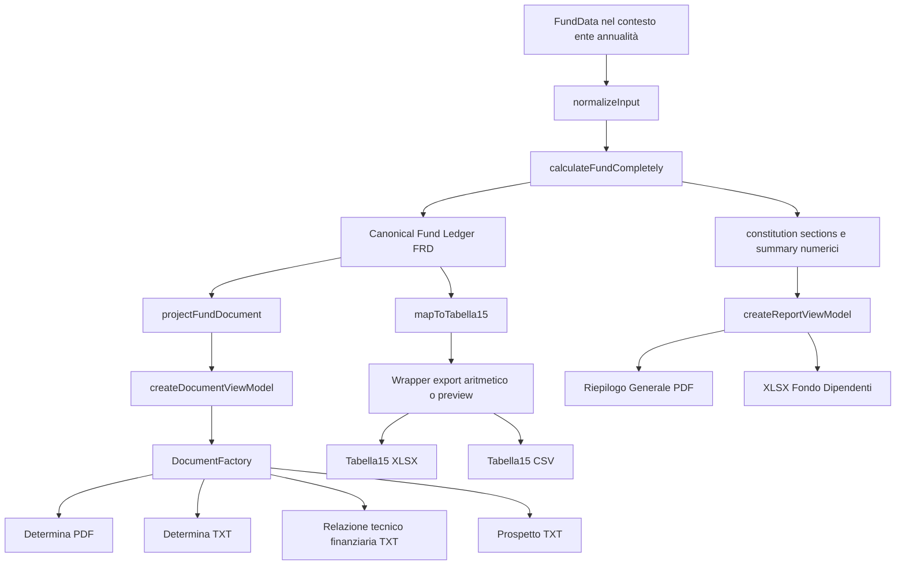

# ASTRA FINAL FINDINGS RECONCILIATION

## A. Executive summary

**Verdict: ASTRA_REFACTOR_REQUIRES_REMAINING_SLICES.**

Audit del **3 ottobre 2026**, repository `dinopusceddu/entilocaliapp`, branch `ux/toolbox-area-fondo-prototype`, HEAD `d3170f959b5815c514dbf3d6e5f93366a5f14c67`. La ricognizione riguarda **il codice del working tree corrente**, distinguendolo dal commit e dall’applicazione reale delle migration. Non certifica lo stato della produzione.

La protezione ordinaria di CLOSED e la chiusura atomica sono consolidate. Il Canonical Fund Ledger ha eliminato il doppio conteggio degli arretrati e il secondo incremento della pagina Fondo; la pipeline moderna dei documenti usa subtotali verificati, totali nullable e modalità bozza. Restano però ingressi economici permissivi, calcoli DL25/PNRR difettosi, una cache autoritativa nella Dirigenza, consumer documentali concorrenti e prerequisiti operativi non condivisi. Il progetto non soddisfa ancora l’invariante “stesso dataset, stesso risultato spiegabile in ogni superficie”.

| Stato | Finding |
|---|---:|
| VERIFIED_FIXED | 5 |
| PARTIALLY_FIXED | 12 |
| OPEN | 8 |
| NOT_VERIFIED | 0 |
| ACCEPTED_LIMITATION | 0 |
| OUT_OF_SCOPE | 0 |
| **Totale** | **25** |

**BLOCKER ancora non integralmente chiusi:** CALC-02 e NORM-01, entrambi PARTIALLY_FIXED. La pagina/core sono corretti, ma l’acceptance end-to-end fallisce negli export attivi. SEC-01, CALC-01 e DOC-01 sono VERIFIED_FIXED nel perimetro esplicitato nelle rispettive sezioni.

**HIGH ancora non integralmente chiusi:** DATA-01, DATA-03, CALC-03, CALC-04, CALC-05, DOC-02, NORM-02, NORM-03, NORM-04, ARCH-01, FUNC-02, UX-02, ACCESS-01. Sono **13** HIGH OPEN/PARTIALLY_FIXED. Nessuna severità originale è stata abbassata per adattarsi ai report successivi.

**Rischi sicurezza aggiuntivi da non perdere nel conteggio dei 25:** creazione Auth senza controllo ADMIN server, password/delete autorizzati dal ruolo denormalizzato, mirror non transazionale e migration profile role non ancora applicata/verificata end-to-end. Non sono spacciati per finding originali di severità BLOCKER: la priorità operativa è alta e impediscono una certificazione generale della sicurezza.

### Fotografia Git e integrità locale

Eseguiti prima dell’analisi: `git status --short --untracked-files=all`, `git branch --show-current`, `git rev-parse HEAD`, `git log -15 --oneline --decorate`. Git è stato usato soltanto in lettura, con optional locks disabilitati.

- **2 file tracked modificati, non staged**, preesistenti: `src/__tests__/securityMigrations.test.ts` e `src/features/wizard2026/__tests__/wizard2026RemoteDraftSync.test.ts`.
- **0 staged**, **386 untracked** al PRE. Fra gli untracked: evidenze/report storici, migration Auth pendente e materiali locali. Nessuna eliminazione/stash/reset.
- Fotografia esterna di **1.041 file tracked+untracked**, con path/dimensione/SHA256. Copia clean-room byte-identica: **0 mismatch**.
- Manifest canonico dei **383 untracked protetti preesistenti**: `3C3675A600A8719704FC283E806CAA38767F34D544C0CE0FB9BD5CBFE8BDE631`. Esclude soltanto `.gitnexus/lbug`, `.gitnexus/lbug.wal`, `audit_wave3_independent/evidence/doc.zip`; metodo ordinamento Ordinal, path TAB size TAB SHA256 uppercase, LF senza newline finale, UTF8 senza BOM.
- `MEMORIA_AI.md` è git-ignored: è fonte locale, non contenuto del commit. Gli ignored/credenziali non sono stati copiati nell’ambiente test e non si dichiara un manifest universale degli ignored.
- Unico nuovo file autorizzato da questo audit: questo report. Il report aggiunge un solo untracked ai 386 del PRE; la conservazione si misura sui path PRE, senza confondere la nuova relazione con un’alterazione della baseline protetta.

| File congelato | SHA256 ricalcolato |
|---|---|
| Migration Auth `20261002000000` | `8670E439CD6FA8AE969652445637168491AFD3388DE710CE2AE9E2752EF2614D` |
| Security test | `4A2217191B161894846271D47C738BA2DEA1B72CC0626504E273958A8305D403` |
| Remote-draft test | `188B79924C5A8D387A58D9ED3AFE6251E1E11AC9FFCECD759A1B694204CFE0F4` |

### Cronologia riconciliata

| Baseline/commit | Contenuto accertato | Limite della dichiarazione storica |
|---|---|---|
| `9f90771` | Baseline ASTRA dopo toolbox/RLS, 25 finding originari | È il PRE del refactoring, non il codice attuale |
| `096056b` | Wave1: immutabilità, RPC atomica, read-only e hardening finale | Il primo implementation report e la prima review non descrivono da soli la RPC finale |
| `fa04801` | Wave2: ledger, current/recovery, anno Art60, zero canonico | “Fixed” nel core non prova tutti i consumer né la validità amministrativa |
| `e52c0cb` | Wave3: proiezione documentale, Tab15, draft/final, attestazioni | Il gate moderno non copre ogni export legacy ancora in Reports |
| `705ad71` | Wave4.1: Cabina, Slice1–3, correlazione locale4A e CLOSED/draft4B | Non è versionamento/CAS server per writer concorrenti |
| `d3170f9` | Security migrations A/B/C | File committato ≠ applicazione di ogni migration in ogni ambiente |
| Working tree corrente | Test Auth/static SQL e mock remote-draft; nuova migration profile | Nessun apply Auth persistente dimostrato; test verde non installa la funzione |

Il riferimento locale `main/origin/main` nel log è `70d533a`; non è stato fatto fetch e non è un’attestazione del remoto aggiornato. La memoria distingue espressamente Wave4.1 locale dalle release/deploy precedenti. Nessuna integrazione o pubblicazione è stata compiuta qui.

### Fonti e gerarchia dell’evidenza

Le descrizioni, severità, expected ed evidenze originali sono recuperati da [ASTRA_RSU_AUDIT_REPORT.md](ASTRA_RSU_AUDIT_REPORT.md), con [ASTRA_NORMATIVE_MATRIX.md](ASTRA_NORMATIVE_MATRIX.md) e [ASTRA_TEST_MATRIX.md](ASTRA_TEST_MATRIX.md). Si sono consultati i report Wave1 di implementation/review/final hardening/consolidation; Wave2 ledger/independent review/worklog/consolidation; Wave3 implementation/independent review/systemic fix/final hardening/verification/wiring/gate/micro gate/draft fix/absolute final gate/test isolation/consolidation; ROLE_ESCALATION, SUPABASE_REAL_RLS, ASTRA baseline/environment e MEMORIA_AI. La ricerca ha individuato inoltre materiali MOD037 e audit precedenti in docs.

Non sono stati trovati report autonomi denominati SLICE per il ciclo recente: Slice1–3/4A/4B e G11 sono descritti nella sezione operativa Wave4.1 della memoria, corroborati dal commit e dai test correnti. Il testo delle release storiche più in basso non è stato interpretato come stato attuale. I gate Auth forniti nella conversazione sono distinti dalle prove rieseguite.

Gerarchia: **codice corrente e percorso raggiungibile → test coerente/prova equivalente → evidenza live storica qualificata → report storico**. Una prova simulata del trigger non è SQL reale; un render jsdom non è screenshot responsive; un oracle numerico non è istruttoria normativa completa.

### Gate rieseguiti senza riscrivere il repository

Le suite sono state eseguite su copia fisica isolata dei file PRE e delle dipendenze già installate, fuori dal repository, senza .env/credenziali e senza installazioni. Usati gli eseguibili locali Node delle medesime dipendenze, equivalenti ai comandi npx/npm richiesti. Variabili runtime: URL `https://example.invalid`, chiave dummy, remote drafts disabilitati, CI=true. Preloader esterno blocca fetch/HTTP/TCP/TLS/DNS; **tentativi registrati: 0**. È stata soppressa soltanto l’apertura GUI automatica di `rollup-plugin-visualizer`, lasciando inalterati plugin/config/file sorgenti.

| Gate | Risultato fresco |
|---|---|
| `git diff --check` sull’originale | Exit0; solo avviso informativo LF/CRLF per il security test |
| `tsc --noEmit` | Exit0 |
| Mirati: Wave1/security/calculation/cabina/pages/contexts/Wizard/presenters/documenti | **41 file,560 test,0 failure** |
| Full Vitest | **111 file,1.242 test,0 failure** |
| Build: `tsc && vite build` | Exit0; warning chunk >500kB, bundle principale circa7,4MB |
| `scripts/run_regression_tests.ts` | **8/8**,0 delta |
| `scripts/run_wave2_oracle.ts` | **14/14** |
| Prove aggiuntive in memoria | Difetti riprodotti; nessun test/file produttivo aggiunto |
| Rete/DB/Auth/runtime app | **0 tentativi rete; nessun login/signup/query remota/fixture DB** |

Il sandbox impediva inizialmente a esbuild di leggere le directory ancestor della copia temporanea; i gate sono stati rieseguiti con l’accesso locale autorizzato. Un primo preload aveva un path Windows mal interpretato, corretto soltanto nel comando temporaneo. Sono failure del lancio harness, non failure applicative omesse. Dopo la correzione non risultano failure nei gate richiesti.

Il full include anche i test indipendenti untracked previsti dall’include Vitest corrente. Non è la suite del solo HEAD pulito: comprende le due modifiche test preesistenti. Le static migration assertions27/27 e il remote-draft mock31/31 non dimostrano uno stato live DB. Le regression golden non sono state rigenerate; regression/oracle sono prove di compatibilità e di14 contratti circoscritti, non copertura dei 25 finding.

### Prove supplementari: risultati che la suite verde non intercetta

| Prova in memoria | Input/perimetro | Actual |
|---|---|---|
| DL25 netto/lordo | TAB100.000, stabile20.000, EQ4.000, spazio finanziario170.000, oneri27,4% | 18.838,304552590267 invece di24.000 |
| PNRR zero | Basi Art33 note, capPNRR0, voce100 | Entry100 VALID/EXCLUDED; canonical VALID; errors[] |
| RIA negativa | Voce−100, resto invariato | canonical INVALID/total=null; boolean Art23 true; dettaglio legacy negativo |
| Cache Dirigenza | Risorse2.000/tetto1.000; cambia solo cache0→2.000 | Consumo0→2.000; conforme true→false |
| Readiness senza atti | Fondo VALID, nessun docMeta | DOCUMENT_FINAL_READY con hasRevisoriParere=false/hasDeliberaGC=false |
| Cabina con blocco | Fondo VALID + compliance error non conforme | CONSTITUTION_VERIFIED; primary “Inizia la Distribuzione”; issue BLOCKING presente |
| A/2025 report legacy | 0141.400, straordinario2.000, Art60127,44, recupero2.800 | total canonico null/verified3.400; stable section.total2.000, variable section.total2.800; righe ancora legacy |
| Alias zero | canonicalDL25=0,legacy900 |0: correzione confermata |

Si tratta di chiamate alle funzioni correnti in memoria. Nessuna ha creato utenti, snapshot persistiti o fixture remote. Il caso VALID delle prove è stato distinto dal primo tentativo con FTE2018 mancante, che risultava correttamente UNDETERMINED per quel diverso prerequisito.

## B. Matrice completa25/25

La severità è quella originale. OPEN e PARTIALLY_FIXED sono stati diversi; “ancora aperti” nell’executive include entrambi quando resta rischio rilevante.

| ID | Severity originale | Stato corrente | Evidenza codice | Evidenza test | Residual risk | Next action |
|---|---|---|---|---|---|---|
| SEC-01 | BLOCKER | VERIFIED_FIXED | `check_user_app_state_immutability`, RLS restrittiva e RPC; migration A/B; `SupabaseStateRepository`. | `securityMigrations.test.ts`; Wave 1 C1–C10 e hardening storico S1–S6/T1–T18. | Applicazione live attestata storicamente su staging; produzione non certificata. Cleanup ADMIN esplicito e DBA esclusi dall’immutabilità ordinaria. | Nessun nuovo fix del difetto originario; mantenere gate DB e traccia dell’eccezione cleanup. |
| DATA-01 | HIGH | OPEN | `src/constants.ts:80,96,258`; `AppContext.tsx:51`; inizializzazione snapshot. | Nessun gate attuale prova “nuovo ente senza importi demo”; inspection della catena di inizializzazione. | Limite 2016 e dati economici apparentemente documentati senza input dell’ente. | `EMPTY_FUND_INITIALIZATION`. |
| DATA-02 | HIGH | VERIFIED_FIXED | `yearClosureWorkflow.ts:132`; adapter `closeYearAtomic`; SQL 20260922140001/150000. | Wave 1 C7–C10; `yearClosure.test.ts`; evidenza storica rollback/conflitti/concorrenza T1–T14. | Readiness istruttoria e concorrenza tra writer OPEN sono problemi diversi ancora aperti. | Conservare RPC come unico adapter remoto di chiusura. |
| DATA-03 | HIGH | PARTIALLY_FIXED | Ledger `amountStatus`; `MonetarySchema`; `FundDataSchema` con `.or(z.any())`; input storici liberi. | L-contract negative; prove memoria RIA−100 → INVALID, art23 boolean ancora true. | Input invalidi restano accettabili in alcuni ingressi e utilizzabili dagli output legacy. | `MONETARY_INPUT_BOUNDARY`. |
| CALC-01 | BLOCKER | VERIFIED_FIXED | `canonicalFundLedger.ts`; engine assegna summary dai verified totals e non aggiunge il vecchio helper. | L1/L2/L3; `wave2AstraCharacterization.test.ts`; oracle `cached-total` e `canonical-zero / legacy-900` e contratto current/recovery. | Recuperi legacy senza istruttoria rimangono UNDETERMINED; export legacy non ereditano sempre questo stato. | Nessun doppio conteggio economico da correggere nel core; completare DOC-02/NORM-02. |
| CALC-02 | BLOCKER | PARTIALLY_FIXED | `FondoAccessorioDipendentePage.tsx:261`; Cabina canonica; `reportPresenter.ts:40` espone sezioni legacy. | Wave 2 e Wave 3 UI wiring; prova A/2025 evidenzia dettaglio report non quadrato. | Pagina e Cabina allineate; acceptance cross-view/export non soddisfatta. | `CANONICAL_FAD_REPORT_PROJECTION`. |
| CALC-03 | HIGH | OPEN | `fundEngine.ts:65–106` calculateSimulazione; `SimulatoreIncrementoForm.tsx` consumer operativo. | Prova memoria 24.000 netto atteso → 18.838,304552590267 effettivo. | Riduzione indebita della facoltà DL25 e divergenza dal Wizard. | `DL25_NET_GROSS_MARGIN`. |
| CALC-04 | HIGH | PARTIALLY_FIXED | Consumo FAD da `verifiedArt23Subject`; consumo Dirigenza ancora da `lim_totaleParzialeRisorseConfrontoTetto2016`. | L11/cache FAD; prova memoria Dirigenza2.000/tetto1.000: cache0 conforme, cache2.000 non conforme. | La classe di difetto resta nel perimetro complessivo dell’ente. | `ART23_DIRIGENZA_DERIVED_CONSUMPTION`. |
| CALC-05 | HIGH | OPEN | `fundEngine.ts:473` maxPnrr>0; entry generica PNRR nel ledger. | Prova memoria max0/voce100 → entry VALID/EXCLUDED, canonical VALID e nessun errore PNRR. | Capienza zero o ignota non impedisce importo positivo; eligibility non governata da un’unica fonte. | `PNRR_ZERO_AND_MISSING_CAP`. |
| DOC-01 | BLOCKER | VERIFIED_FIXED | `tabella15Mapper.ts`; `tabella15XlsService.ts`; source ledger, signedAmount, unresolved mapping. | `documentConsistencyWave3`, `wave3SystemicFix`, `wave3HardeningEvidence` e test mapper. | Schema annuale ministeriale non validato; readiness aritmetica non è SICO readiness. | Preservare limite esplicito; gate RGS dedicato se richiesto. |
| DOC-02 | HIGH | PARTIALLY_FIXED | Proiezione/presenter/DocumentFactory moderni; bypass attivi `documents/pdfReportService.ts` e `documents/xlsReportService.ts`. | 34 consistency+21 systemic+19 wiring+7 hardening; prove memoria legacy e readiness. | PDF/XLS riepilogativi non qualificano bozza/missing; readiness finale soltanto numerica. | `CANONICAL_FAD_REPORT_PROJECTION`, poi `DOCUMENT_KIND_READINESS`. |
| NORM-01 | BLOCKER | PARTIALLY_FIXED | `conglobamentoArt60.ts`; ledger year<2026→0; sections legacy conservano Art60 manuale 2025. | Oracle O060-2025/2026; ccnl/conglobamento tests; prova report A/2025. | Regola corretta nel core; rappresentazione documentale legacy ancora contraddittoria nel2025. | `CANONICAL_FAD_REPORT_PROJECTION`. |
| NORM-02 | HIGH | PARTIALLY_FIXED | `ccnl2026Increments`; ledger current/recovery; metadata `annualita022Considerate` corretta; consumer legacy residui. | Oracle O0222024/25/26/27; L3/recovery UNDETERMINED; prove report memoria. | Recuperi non validati appaiono quantificati negli export separati; cap/compliance non governa readiness finale. | `CANONICAL_FAD_REPORT_PROJECTION`; poi `CCNL_RECOVERY_INSTRUCTION`. |
| NORM-03 | HIGH | OPEN | calculateSimulazione include sempre fase3 L296; firma senza data/regime. | Inspection firma/min; test Wizard Art33 non provano questo consumer. | Vincolo storico applicato anche dove la matrice congelata prevede esclusione dopo8/8/2026. | `DL25_TEMPORAL_REGIME`. |
| NORM-04 | HIGH | OPEN | `Step3Dl25.tsx:53,200,473,490`; `Step8RiepilogoPreview.tsx:358`. | Step3/Step8 tests presenti e verdi; non asseriscono il corretto anno-base/refuso. | Utente fornisce una base sbagliata pur con formula numerica corretta. | `DL25_BASE_YEAR_LABELS`. |
| ARCH-01 | HIGH | PARTIALLY_FIXED | Resolver zero canonico, ledger source; vecchio helper e `calculateFadTotals`/sections a contratto diverso. | L-contract zero/provenance e oracle; prova memoria DL25canon0/legacy900→0. | Fonti economiche allineate nel core ma sezioni/documenti concorrenti restano. | `CANONICAL_FAD_REPORT_PROJECTION`; ritiro helper in slice separato. |
| ARCH-02 | MEDIUM | PARTIALLY_FIXED | Policy is_admin/get_my_role da profiles; state owner canonico; Edge Functions ancora `user_app_state.role`. | Authorization/ownership/RLS simulation e storico ROLE_ESCALATION; static auth SQL; nessuna prova Edge completa. | Metadata denormalizzati continuano a essere autorità in password/delete; profile Auth fix non applicato. | `AUTH_ADMIN_01_SERVER_ADMIN_CHECK`, poi gli altri gate Auth separati. |
| FUNC-01 | HIGH | VERIFIED_FIXED | Guardie CLOSED reducer/save/autosave, MainLayout e pagine; Wave4.1 blocca import/rollback/metadati. | 35 AppContext.closedHardening; page CLOSED; Wave1 C2/C5/C6 e storico T17/T18. | Export read-only può ancora essere semanticamente errato: DOC-02, non una mutazione CLOSED. | Mantenere regressioni per tutti i writer e import. |
| FUNC-02 | HIGH | PARTIALLY_FIXED | Resolver Cabina da canonical status; checklist separata; Distribuzione auto-performance e personale??0. | Resolver/page integration; prova VALID+BLOCKING→CONSTITUTION_VERIFIED/inizia distribuzione. | Validità monetaria viene ancora usata come completezza amministrativa/negoziale. | `CABINA_BLOCKING_ISSUE_PRIORITY`, poi `DISTRIBUTION_EXPLICIT_DRAFT`. |
| FUNC-03 | MEDIUM | OPEN | `Wizard2026SummaryPanel.tsx:280`; Step8 transfer operativo. | SummaryPanel/Step8/transfer test; testo disabled confermato staticamente. | Contraddizione persistente sulla disponibilità dell’azione. | `WIZARD_SINGLE_TRANSFER_ACTION`. |
| UX-01 | MEDIUM | PARTIALLY_FIXED | Ledger entry/provenance, proiezione unresolved, guide; nessun quadro amministrativo completo. | L provenance e documenti; nessuna ripetizione completa15 risposte RSU. | Tracciabilità tecnica non equivale a dossier leggibile e documentabile. | `RESOURCE_PROVENANCE_READ_MODEL`. |
| UX-02 | HIGH | PARTIALLY_FIXED | `AreaFondoContextBar.tsx` sticky/ente/anno/stato; nome truncate+title; ownership nel popover. | UX e Cabina integration; storico Wave4.1 visuale; nessun nuovo gate360/390/430 completo. | Nome completo affidato al title e contesto non provato durante scroll/dialog sui telefoni. | `MOBILE_FUND_CONTEXT`. |
| UX-03 | MEDIUM | PARTIALLY_FIXED | CTA Cabina migliorate; Mapping Preview/legacyField, metadata opinionOutcome ecc. esposti. | Cabina integration/page navigation; inspection Wizard/Reports. | Lessico di sviluppo e CTA contraddittorie persistono in schermate operative. | `RSU_BUSINESS_LABELS` e `WIZARD_SINGLE_TRANSFER_ACTION`. |
| ACCESS-01 | HIGH | OPEN | Modale custom Nuovo ente in `FondiEntiPage.tsx:697`; shared `Modal.tsx`. | Nessuna prova attuale focus trap/Escape/focus return; causa assente nel codice. | Utente tastiera interagisce con lo sfondo; dialog senza semantica completa. | `NEW_ENTITY_DIALOG_KEYBOARD`. |
| ACCESS-02 | MEDIUM | OPEN | Reports7 label/input senza htmlFor/id; Card role=button con button interno; toggle mobile Wizard div. | Inspection markup; test Reports non cercano tutti i campi per accessible name. | Nomi mancanti, duplicazione trigger e navigazione tastiera non uniforme. | `REPORT_METADATA_ACCESSIBLE_NAMES`, poi `SINGLE_ACCORDION_TRIGGER`. |

## C. Analisi dettagliata dei 25 finding

### SEC-01 — Snapshot chiuso modificabile tramite API dal proprietario

**Severity originale:** BLOCKER. **Stato corrente:** VERIFIED_FIXED.

**Scenario originale:** B/2026 chiuso; UPDATE autenticato USER_A con marcatore temporaneo.

**Problema originale:** Una riga aggiornata; marcatore persistito. Il workflow ordinario rifiuta invece la modifica.

**Expected/acceptance originale:** Vincolo di immutabilità imposto anche sul server, con eventuale riapertura esplicita autorizzata. UPDATE diretto del proprietario sul chiuso rifiutato; chiusura consentita una volta; riapertura solo secondo policy verificabile.

**Evidenza ASTRA originale:** STAGING_WORKFLOW_EXPORT.json. **Superficie/root cause originaria:** API staging / user_app_state; snapshotWorkflow.ts verifica CLOSED nel client; il database staging accetta UPDATE sul record chiuso.

**Implementazione e analisi corrente:**

La Wave 1 ha portato il vincolo nel database; la review iniziale aveva ancora NF-01/NF-02, risolti dalle definizioni forward-only finali, non dalla prima RPC. La migration A del 28 settembre blocca INSERT CLOSED, UPDATE di OLD CLOSED e chiusura diretta; aggiunge una policy UPDATE RESTRICTIVE per impedire che un client autenticato aggiri il vincolo tramite una variabile di sessione. La migration B revoca EXECUTE da PUBLIC/anon sulla firma esatta della RPC. Il percorso ordinario non dispone di riapertura implicita.

Catena attuale: pagina/reducer → workflow save → adapter Supabase → RLS/trigger. La prova locale C3/C4 simula il trigger e non è SQL reale: la prova equivalente server è il materiale storico di hardening e l’ispezione delle migration finali. Non è stata rieseguita contro un DB. Il caso originale UPDATE owner su CLOSED è coperto senza un bypass applicativo evidente. Non si estende questo verdetto all’Auth, agli amministratori di database o alla produzione.

L’eccezione DELETE richiede sia `app.allow_admin_cleanup=true` sia `public.is_admin()=true`: è una policy amministrativa deliberata, non il normale UPDATE oggetto del finding. Va resa esplicita quando si afferma “immutabile”.

**File/simboli:** `check_user_app_state_immutability`, RLS restrittiva e RPC; migration A/B; `SupabaseStateRepository`.

**Test/prova:** `securityMigrations.test.ts`; Wave 1 C1–C10 e hardening storico S1–S6/T1–T18.

**Motivazione e rischio residuo:** Applicazione live attestata storicamente su staging; produzione non certificata. Cleanup ADMIN esplicito e DBA esclusi dall’immutabilità ordinaria. Lo stato riflette l’acceptance sopra e la presenza/assenza del percorso concorrente descritto; non il solo esito della suite.

**Next action:** Nessun nuovo fix del difetto originario; mantenere gate DB e traccia dell’eccezione cleanup.

### DATA-01 — Valori dimostrativi diventano dati del nuovo Fondo

**Severity originale:** HIGH. **Stato corrente:** OPEN.

**Scenario originale:** A/2026 e B/2026 senza dati storici forniti.

**Problema originale:** Limite 1.730.000 euro e straordinario 50.000 euro; controlli superati.

**Expected/acceptance originale:** Storici mancanti e verifica non determinabile fino alla loro documentazione. Nuovo ente e nuovo anno non mostrano importi non inseriti; nessuna conformità conclusiva con storici mancanti.

**Evidenza ASTRA originale:** P22_A2026_defaults.txt; P29_closed_dashboard.txt; P30_closed_edit.txt. **Superficie/root cause originaria:** Nuova annualità / Verifica; src/constants.ts:80 e :284; AppContext idrata con valori iniziali.

**Implementazione e analisi corrente:**

La catena usa tuttora `INITIAL_HISTORICAL_DATA`, `INITIAL_ANNUAL_DATA` e `INITIAL_SIMULATORE_INPUT` nel FundData iniziale. Sono presenti FRD2016 1.200.000, EQ150.000, Dirigenza300.000, Segretario30.000, straordinario50.000: il totale storico è ancora 1.730.000. Anche stipendi2023, fondi2018 e input del simulatore contengono valori dimostrativi.

Catena: nuovo contesto → defaultFundData AppContext → initializeAnnualSnapshot/nuovo anno → normalizeInput → limite storico/compliance. Il ledger introduce missing prerequisites per alcune basi, ma non distingue un importo demo da uno fornito dall’ente. Un test verde con questi default non costituisce prova di completezza. Nessuna correzione elimina la causa originaria: servono inizializzazione vuota e provenienza dei dati, senza cancellare gli snapshot esistenti.

**File/simboli:** `src/constants.ts:80,96,258`; `AppContext.tsx:51`; inizializzazione snapshot.

**Test/prova:** Nessun gate attuale prova “nuovo ente senza importi demo”; inspection della catena di inizializzazione.

**Motivazione e rischio residuo:** Limite 2016 e dati economici apparentemente documentati senza input dell’ente. Lo stato riflette l’acceptance sopra e la presenza/assenza del percorso concorrente descritto; non il solo esito della suite.

**Next action:** `EMPTY_FUND_INITIALIZATION`.

### DATA-02 — Chiusura parziale non recuperabile con un nuovo tentativo

**Severity originale:** HIGH. **Stato corrente:** VERIFIED_FIXED.

**Scenario originale:** Errore simulato nella creazione del successivo, dopo salvataggio CLOSED.

**Problema originale:** Anno corrente resta CLOSED; successivo assente; retry risponde già chiuso. Prova in memoria, non guasto indotto sul database.

**Expected/acceptance originale:** Transazione atomica o workflow riprendibile e idempotente. Errore a ogni passo lascia tutti i dati coerenti oppure riprende il trasferimento senza duplicarlo.

**Evidenza ASTRA originale:** SUPPLEMENT_PROBES.json / partialClosure. **Superficie/root cause originaria:** Chiusura annualità; yearClosureWorkflow.ts: salvataggi separati ai passi 5, 6 e 7; nessun rollback.

**Implementazione e analisi corrente:**

Il runtime Supabase usa `closeYearAtomic` e la RPC `close_annual_snapshot_atomic(uuid,integer,jsonb,jsonb)`. Il server autorizza owner o ADMIN canonico, acquisisce lock, congela dati DB, impone metadati di chiusura e preserva la bozza N+1 aggiornando il solo riporto consentito. Conflitti producono rollback; il retry gestisce l’operazione già completata e il recovery del precedente stato CLOSED senza successivo.

La definizione finale prevale sul primo implementation report, che descriveva ancora overwrite e bypass diversi. Le prove storiche T3/T4, T6/T8 e T9 coprono conservazione N+1, rollback e doppio submit. I test locali sono rieseguiti, senza simulare un guasto sul DB.

Esiste un fallback compensativo se una repository non implementa la RPC: è usato da mock/in-memory, non dall’adapter Supabase attuale. Non è una transazione ACID e non va riutilizzato per un adapter remoto. Il finding originale è chiuso sul percorso remoto effettivo; non significa che sia corretto chiudere un’istruttoria incompleta (FUNC-02).

**File/simboli:** `yearClosureWorkflow.ts:132`; adapter `closeYearAtomic`; SQL 20260922140001/150000.

**Test/prova:** Wave 1 C7–C10; `yearClosure.test.ts`; evidenza storica rollback/conflitti/concorrenza T1–T14.

**Motivazione e rischio residuo:** Readiness istruttoria e concorrenza tra writer OPEN sono problemi diversi ancora aperti. Lo stato riflette l’acceptance sopra e la presenza/assenza del percorso concorrente descritto; non il solo esito della suite.

**Next action:** Conservare RPC come unico adapter remoto di chiusura.

### DATA-03 — Importi negativi ammessi in risorse additive

**Severity originale:** HIGH. **Stato corrente:** PARTIALLY_FIXED.

**Scenario originale:** RIA−100 e tabellari2023−100.

**Problema originale:** RIA riduce il consumo art23 da10.000 a9.900 mantenendo conformità; tabellari negativi accettati nella UI.

**Expected/acceptance originale:** Invalidare dati economici non negativi, distinguendoli dalle decurtazioni positive da sottrarre. RIA−100 produce errore associato al campo e nessuna conformità conclusiva; decurtazioni usano segno controllato.

**Evidenza ASTRA originale:** P12_negative_constitution.txt; P04_dl25_negative.txt. **Superficie/root cause originaria:** Costituzione RIA / Wizard DL25; Validazione non uniforme tra input e motore; il risultato numerico resta utilizzabile.

**Implementazione e analisi corrente:**

Il ledger assegna INVALID a risorse additive negative, non le include nei subtotali verificati e rende il totale finale null. `MonetarySchema` definisce nonnegative e massimo due decimali. Questo corregge una parte sostanziale del difetto.

La validazione complessiva resta permissiva: le sezioni fondi del `FundDataSchema` accettano `.optional().or(z.any())`; storici e input simulatore usano `numberOrUndefined` senza nonnegative. Il campo RIA può ancora arrivare al calcolo attraverso un percorso che non garantisce errore associato al controllo. Nella prova in memoria RIA−100 il ledger è INVALID/total=null, ma `compliance.art23c2.isCompliant=true` e le sezioni legacy contengono il negativo (stabili1.900 nel dataset di prova). I documenti riepilogativi non leggono quel gate INVALID.

Non va confusa una decurtazione valida, rappresentata come importo positivo più operazione DEDUCTION, con una risorsa additiva negativa. Servono validation ingress/UI/import, stato di verifica non conclusivo e tutti i consumer protetti.

**File/simboli:** Ledger `amountStatus`; `MonetarySchema`; `FundDataSchema` con `.or(z.any())`; input storici liberi.

**Test/prova:** L-contract negative; prove memoria RIA−100 → INVALID, art23 boolean ancora true.

**Motivazione e rischio residuo:** Input invalidi restano accettabili in alcuni ingressi e utilizzabili dagli output legacy. Lo stato riflette l’acceptance sopra e la presenza/assenza del percorso concorrente descritto; non il solo esito della suite.

**Next action:** `MONETARY_INPUT_BOUNDARY`.

### CALC-01 — Arretrati 0,14% contati due volte

**Severity originale:** BLOCKER. **Stato corrente:** VERIFIED_FIXED.

**Scenario originale:** MS2021 un milione; arretrati trasferiti 2.800 euro.

**Problema originale:** Motore/cabina variabile 5.600; atteso contabile 2.800. Totale 8.872,56 contro 6.072,56: +2.800.

**Expected/acceptance originale:** Ogni risorsa concorre una sola volta. Il totale atteso è solo riconciliazione aritmetica, non certificazione giuridica del 2025. Con il dataset A: stabile 3.272,56; variabile 2.800; somma contabile 6.072,56 in tutte le viste, prima dei correttivi normativi.

**Evidenza ASTRA originale:** P09_summary.txt; P15_resumed_dashboard.txt; PASS3_EXPECTED_FROZEN.json/OLEDGER; STAGING_WORKFLOW_EXPORT.json. **Superficie/root cause originaria:** Wizard → Cabina → Personale; fundCalculations.ts:146–155 non esclude la voce arretrati importata; fundEngine aggiunge nuovamente la componente CCNL.

**Implementazione e analisi corrente:**

Il ledger esclude le special keys dal passaggio generico e introduce una sola entry semantica per current e una distinta per recovery. Gli ID duplicati sono rifiutati. Il motore non somma più il risultato CCNL legacy ai campi trasferiti; il risultato FAD numerico di compatibilità deriva dai verified totals.

La riproduzione A/2025 conserva il recupero legacy2.800 come UNDETERMINED: verified stable3.400, verified variable0, total=null. Non ritorna5.600 e non trasforma l’assenza di istruttoria in un totale definitivo. L’atteso contabile storico6.072,56 non è l’atteso normativo corretto del2025, per effetto di Art60 e recuperi non documentati.

Il difetto specifico della seconda addizione2.800 è eliminato nel percorso Wizard→transfer→normalizer→engine. I problemi di presentazione del recupero non validato negli export separati sono ancora presenti e classificati in NORM-02/DOC-02, senza fingere che il doppio conteggio continui nel core.

**File/simboli:** `canonicalFundLedger.ts`; engine assegna summary dai verified totals e non aggiunge il vecchio helper.

**Test/prova:** L1/L2/L3; `wave2AstraCharacterization.test.ts`; oracle `cached-total` e `canonical-zero / legacy-900` e contratto current/recovery.

**Motivazione e rischio residuo:** Recuperi legacy senza istruttoria rimangono UNDETERMINED; export legacy non ereditano sempre questo stato. Lo stato riflette l’acceptance sopra e la presenza/assenza del percorso concorrente descritto; non il solo esito della suite.

**Next action:** Nessun doppio conteggio economico da correggere nel core; completare DOC-02/NORM-02.

### CALC-02 — La pagina Personale aggiunge ancora lo 0,14%

**Severity originale:** BLOCKER. **Stato corrente:** PARTIALLY_FIXED.

**Scenario originale:** Stesso A/2025.

**Problema originale:** Stabile 4.672,56 e totale disponibile 10.272,56; cabina 3.272,56 e 8.872,56. Scarto ulteriore +1.400.

**Expected/acceptance originale:** La pagina consuma il medesimo risultato canonico della cabina. Cabina, Personale, distribuzione ed export concordano al centesimo per risorse importate e manuali.

**Evidenza ASTRA originale:** P11_stable.txt; PASS1_BLACKBOX.md. **Superficie/root cause originaria:** Fondo Personale / totale disponibile; FondoAccessorioDipendentePage.tsx:330 chiama calculateFadTotals senza il parametro CCNL, poi aggiunge le componenti alle righe 346–358.

**Implementazione e analisi corrente:**

La pagina Fondo Personale non aggiunge più nuovamente0,14% al totale; usa `canonicalFund.verifiedStableTotal/verifiedVariableTotal/verifiedTotal` e visualizza lo stato indeterminato. Cabina usa il totale nullable e il subtotale verificato separato. Il vecchio scarto pagina+1.400 è corretto.

L’acceptance originaria richiede però concordanza anche con distribuzione ed export. `createReportViewModel` passa le `constitution.sections` del motore, prodotte ancora da `calculateFadTotals`, a PDF/XLS. Nella prova A/2025 il dettaglio stable contiene le righe2.000+1.400−127,44 ma dichiara section.total2.000; il totale compatibile3400 non coincide né con quelle righe né con il totale delle sezioni. L’XLS attivo scrive entrambi senza riconciliazione.

La pagina è corretta per il doppio incremento, ma non basta a chiudere l’invariante richiesta su tutti i consumer. Distribuzione legge inoltre un numero verificato senza qualificare l’indeterminatezza (FUNC-02).

**File/simboli:** `FondoAccessorioDipendentePage.tsx:261`; Cabina canonica; `reportPresenter.ts:40` espone sezioni legacy.

**Test/prova:** Wave 2 e Wave 3 UI wiring; prova A/2025 evidenzia dettaglio report non quadrato.

**Motivazione e rischio residuo:** Pagina e Cabina allineate; acceptance cross-view/export non soddisfatta. Lo stato riflette l’acceptance sopra e la presenza/assenza del percorso concorrente descritto; non il solo esito della suite.

**Next action:** `CANONICAL_FAD_REPORT_PROJECTION`.

### CALC-03 — Simulatore DL25 riduce anche il margine netto per gli oneri

**Severity originale:** HIGH. **Stato corrente:** OPEN.

**Scenario originale:** TAB23=300.000, stabile=100.000, EQ=20.000; margini finanziari capienti; oneri27,4%.

**Problema originale:** Margine48%=24.000 ma netto finale18.838,30. Scarto −5.161,70.

**Expected/acceptance originale:** min(24.000, margine finanziario lordo/1,274); qui24.000. Caso margine48 vincolante=24.000; caso margine finanziario vincolante=spazio/(1+oneri), IRAP gestita separatamente.

**Evidenza ASTRA originale:** SUPPLEMENT_PROBES.json/simulator. **Superficie/root cause originaria:** Simulatore incremento; fundEngine.ts:81–106 applica min a grandezze non omogenee, poi divide tutto per gli oneri.

**Implementazione e analisi corrente:**

La funzione calcola `min(margine48, margineArt33, margineL296)` e divide tutto per 1+oneri. Il margine48 è già espresso come risorsa netta Fondo, mentre i margini finanziari sono lordi: non sono grandezze omogenee.

La prova fresca usa TAB2023=100.000, fondo stabile20.000, EQ4.000 (stesso margine netto24.000 del caso originale), spazio Art33=170.000, L296=400.000, oneri27,4%. L’output è ancora18.838,304552590267 invece di24.000. La funzione è re-esportata da `simulatoreCalculations.ts` ed è chiamata dal form; non è codice morto.

Il calcolatore Wizard `calculateDl25Increment` determina il limite teorico con un contratto diverso; la presenza di test corretti su quel calcolatore non dimostra la correzione del simulatore. Nessun nuovo calcolo è stato implementato.

**File/simboli:** `fundEngine.ts:65–106` calculateSimulazione; `SimulatoreIncrementoForm.tsx` consumer operativo.

**Test/prova:** Prova memoria 24.000 netto atteso → 18.838,304552590267 effettivo.

**Motivazione e rischio residuo:** Riduzione indebita della facoltà DL25 e divergenza dal Wizard. Lo stato riflette l’acceptance sopra e la presenza/assenza del percorso concorrente descritto; non il solo esito della suite.

**Next action:** `DL25_NET_GROSS_MARGIN`.

### CALC-04 — Un totale denormalizzato può ribaltare la conformità art23

**Severity originale:** HIGH. **Stato corrente:** PARTIALLY_FIXED.

**Scenario originale:** Risorse soggette2.000; tetto1.000; aggiunta cl_totaleParziale...=0.

**Problema originale:** Senza cache non conforme; con cache0 valore soggetto0 e conforme, a parità di voci. Prova diretta del motore.

**Expected/acceptance originale:** Totali sempre derivati; copie obsolete non comandano il controllo. Cambiare/eliminare il campo derivato non cambia consumo e conformità calcolati dalle voci.

**Evidenza ASTRA originale:** SUPPLEMENT_PROBES.json/cachedTotal. **Superficie/root cause originaria:** Motore / snapshot legacy; fundEngine.ts:331 preferisce il totale fornito alla somma; percorso UI di immissione della cache non dimostrato.

**Implementazione e analisi corrente:**

La cache FAD `cl_totaleParzialeRisorsePerConfrontoTetto2016` è ora una riconciliazione: il ledger genera warning e il motore deriva il consumo dalle entry. L’override originario sul Fondo dipendenti non comanda più la conformità.

Resta però un percorso concorrente evidente nello stesso controllo globale: `dirigenzaCorrenteRilevante` legge `fondi.dirigenza.lim_totaleParzialeRisorseConfrontoTetto2016 || 0`. La prova fresca mantiene risorse Dirigenza2.000 e tetto1.000 identici; cambiando soltanto la cache0→2.000 il valore soggetto passa0→2.000 e isCompliant true→false. La presenza della dirigenza abilita questo percorso ordinario.

Poiché l’expected originario richiede totali sempre derivati e Art23 riguarda l’intera amministrazione, il fix FAD non chiude l’intero finding. Non viene proposta una ricerca normativa nuova: serve applicare al perimetro Dirigenza il medesimo principio già approvato.

**File/simboli:** Consumo FAD da `verifiedArt23Subject`; consumo Dirigenza ancora da `lim_totaleParzialeRisorseConfrontoTetto2016`.

**Test/prova:** L11/cache FAD; prova memoria Dirigenza2.000/tetto1.000: cache0 conforme, cache2.000 non conforme.

**Motivazione e rischio residuo:** La classe di difetto resta nel perimetro complessivo dell’ente. Lo stato riflette l’acceptance sopra e la presenza/assenza del percorso concorrente descritto; non il solo esito della suite.

**Next action:** `ART23_DIRIGENZA_DERIVED_CONSUMPTION`.

### CALC-05 — Massimo PNRR zero non blocca un incremento positivo

**Severity originale:** HIGH. **Stato corrente:** OPEN.

**Scenario originale:** Massimo PNRR dichiarato0; voce PNRR100.

**Problema originale:** Totale variabile100, escluso art23; nessun errore PNRR nel risultato.

**Expected/acceptance originale:** Zero verificato deve impedire un positivo; massimo mancante deve essere indeterminato. max0 e voce100 falliscono; missing non conforme conclusivo; massimo positivo confrontato al centesimo.

**Evidenza ASTRA originale:** SUPPLEMENT_PROBES.json/pnrrZeroMax. **Superficie/root cause originaria:** Motore / costituzione; fundEngine.ts:493 controlla superamento solo quando maxPnrr>0.

**Implementazione e analisi corrente:**

Il controllo conserva `if (maxPnrr > 0 && pnrrVal > maxPnrr + 0.01)`. Zero e undefined, convertito a0, saltano il confronto. Il ledger riceve il PNRR come risorsa generica non negativa e non ne riesegue condizioni/capienza.

La prova fresca rende note le basi Art33 per non confondere prerequisiti indipendenti con il finding: maxPnrr0 e importo100 producono una entry VALID, esclusa Art23, un fondo canonical VALID e errors[]. Il calcolatore Wizard PNRR ha gate2023–2026 e requisiti, ma non governa il dato manuale già persistito in Costituzione; anche la UI limita l’importo soltanto quando il massimo è positivo.

La distinzione richiesta è zero verificato vs dato mancante, con controllo al centesimo per un massimo positivo. Non si assume che la questione normativa autonoma “soggetto attuatore”, classificata UNCERTAIN nell’audit, sia stata risolta.

**File/simboli:** `fundEngine.ts:473` maxPnrr>0; entry generica PNRR nel ledger.

**Test/prova:** Prova memoria max0/voce100 → entry VALID/EXCLUDED, canonical VALID e nessun errore PNRR.

**Motivazione e rischio residuo:** Capienza zero o ignota non impedisce importo positivo; eligibility non governata da un’unica fonte. Lo stato riflette l’acceptance sopra e la presenza/assenza del percorso concorrente descritto; non il solo esito della suite.

**Next action:** `PNRR_ZERO_AND_MISSING_CAP`.

### DOC-01 — Tabella 15 perde voci e inverte l’effetto delle decurtazioni

**Severity originale:** BLOCKER. **Stato corrente:** VERIFIED_FIXED.

**Scenario originale:** A/2025 con trasferimento straordinario 2.000 e art60 127,44.

**Problema originale:** Stabile 1.527,44, variabile 2.800, totale 4.327,44; ente generico Ente. Decurtazione sommata positiva e trasferimento assente.

**Expected/acceptance originale:** Riconciliazione con registro, sottrazioni corrette e identificazione ente/anno. Totali e segni riconciliati; tutte le differenze motivate; nome corretto; nessuna pretesa di conformità istituzionale senza schema verificato.

**Evidenza ASTRA originale:** P17_table15.txt; exports/Tabella15_Ente_2025.csv; exports/XLSX_EXTRACT.txt. **Superficie/root cause originaria:** Anteprima / XLS / CSV Tabella 15; tabella15Mapper.ts:37 conserva amount senza operatore; somma solo voci mappate; metadata del motore omette nome ente.

**Implementazione e analisi corrente:**

Il mapper canonico conserva tutte le entry economiche valide, applica il segno DEDUCTION e include il trasferimento straordinario. Voci senza classificazione hanno `RGS_MAPPING_UNRESOLVED`: l’importo non sparisce e l’export aritmetico definitivo è bloccato. Il nome ente arriva dai metadata corretti/override e l’anno è esposto.

Il grandTotal non è definitivo per INVALID/UNDETERMINED; i wrapper definitivi verificano stato, totale e assenza di classificazioni irrisolte. Round di entry e totali usa FinancialMath. Le prove Wave3 verificano quadratura e sottrazioni, inclusi casi frazionari e incompletezza.

`schemaVerificationStatus=RGS_SCHEMA_UNVERIFIED`, `isSicoExportReady=false` e `isExportReady=false` sono mantenuti; CSV dichiara schema non verificato/SICO NO e XLSX espone lo stato schema. Questo soddisfa il finding aritmetico e impedisce una falsa certificazione ministeriale. Non equivale a validazione dello schema annuale, che rimane una limitazione esterna esplicita.

**File/simboli:** `tabella15Mapper.ts`; `tabella15XlsService.ts`; source ledger, signedAmount, unresolved mapping.

**Test/prova:** `documentConsistencyWave3`, `wave3SystemicFix`, `wave3HardeningEvidence` e test mapper.

**Motivazione e rischio residuo:** Schema annuale ministeriale non validato; readiness aritmetica non è SICO readiness. Lo stato riflette l’acceptance sopra e la presenza/assenza del percorso concorrente descritto; non il solo esito della suite.

**Next action:** Preservare limite esplicito; gate RGS dedicato se richiesto.

### DOC-02 — Documenti con componenti non riconciliate e attestazioni automatiche

**Severity originale:** HIGH. **Stato corrente:** PARTIALLY_FIXED.

**Scenario originale:** Generazione TXT/PDF da A/2025 incompleto.

**Problema originale:** Relazione: stabile2.000+variabile0 ma totale8.872,56; Prospetto uguale. Determina2025 cita applicazione2026, attesta parere favorevole con estremi vuoti e mostra3.400 come stabile al netto di127,44.

**Expected/acceptance originale:** Bozza dichiarata tale, somme complete, competenza coerente, attestazioni solo da dati verificati. Componenti sommano al totale; documento incompleto marcato BOZZA; nessun parere favorevole inventato; anno e basi corretti.

**Evidenza ASTRA originale:** exports/*.txt; exports/PDF_page-1.png; exports/PDF_page-2.png; P16_documents.txt. **Superficie/root cause originaria:** Stampe e Report; documentFactory.ts usa totali soggetti per le componenti e totale complessivo; template assertivo, dati placeholder.

**Implementazione e analisi corrente:**

La pipeline moderna Determina PDF/TXT, Relazione TXT e Prospetto TXT legge `projectFundDocument`, separa subtotale/totale nullable e applica modalità DRAFT_PREVIEW/DEFINITIVE_EXPORT. Anche un fondo VALID in preview produce BOZZA; UNDETERMINED non sblocca gli export definitivi. Revisori e Giunta sono attestati solo con esiti/stati espliciti e relativi estremi; UNKNOWN/non documentato produce testo neutro, non favorevole inventato.

Restano due bypass operativi da Reports: Riepilogo Generale PDF e XLS Fondo. Gli handler controllano solo l’esistenza del risultato; reportPresenter passa sections legacy e i generatori scrivono totali numerici con etichette definitive, senza draft/readiness. La prova A/2025 dimostra dettagli/subtotali non riconciliati e recupero2.800 mostrato mentre il totale canonico è null.

Inoltre `isDefinitiveDocumentReady=isDetermined`: un canonical VALID senza metadata Revisori/GC diventa DOCUMENT_FINAL_READY. Non affermo che ogni tipo di atto richieda universalmente entrambi; manca però una policy dei prerequisiti distinta per documento, che includa blocchi normativi e placeholder essenziali. La vecchia Determina TXT resta esportata nel service ma non ha un chiamante UI attuale: debito latente, distinto dai due bypass attivi.

**File/simboli:** Proiezione/presenter/DocumentFactory moderni; bypass attivi `documents/pdfReportService.ts` e `documents/xlsReportService.ts`.

**Test/prova:** 34 consistency+21 systemic+19 wiring+7 hardening; prove memoria legacy e readiness.

**Motivazione e rischio residuo:** PDF/XLS riepilogativi non qualificano bozza/missing; readiness finale soltanto numerica. Lo stato riflette l’acceptance sopra e la presenza/assenza del percorso concorrente descritto; non il solo esito della suite.

**Next action:** `CANONICAL_FAD_REPORT_PROJECTION`, poi `DOCUMENT_KIND_READINESS`.

### NORM-01 — Articolo 60 applicato nel 2025

**Severity originale:** BLOCKER. **Stato corrente:** PARTIALLY_FIXED.

**Scenario originale:** Un funzionario, anno 2025.

**Problema originale:** Riduzione 127,44 euro calcolata, trasferita e sottratta.

**Expected/acceptance originale:** Riduzione zero nel 2025; decorrenza 1 gennaio 2026 per l’ipotesi del 3 novembre 2025. 2025=0; 2026 un funzionario=127,44; 2027 consolidamento esplicito senza ricalcolare la platea corrente.

**Evidenza ASTRA originale:** P06_art60_2025.txt; PASS5_ORACLE_COMPARISON.json/O060-2025. **Superficie/root cause originaria:** Wizard step conglobamento; conglobamentoArt60.ts:53/89 distingue solo anni successivi al 2026, non quelli anteriori.

**Implementazione e analisi corrente:**

Wizard e ledger applicano ora la decorrenza: 2025=0, 2026 funzionario intero127,44; per2027 occorre consolidamento esplicito senza ricalcolare la platea corrente. Il ledger ignora Art60 legacy2025 con warning e conserva distinti effetto economico e computo figurativo Art23. Le prove matematiche previste dall’audit passano.

Non è chiuso end-to-end: l’engine conserva in `fondi.dipendente.constitution.sections` le righe manuali legacy non filtrate per anno. PDF riepilogativo e XLS Fondo, ancora raggiungibili in Reports, consumano quelle righe: nel caso2025 mostrano/sottraggono Art60=127,44 nel dettaglio mentre il ledger ha0. Non è una nuova ricerca di vigenza ma una contraddizione rispetto alla regola N09 già congelata.

Il fix del core è reale; la presenza del percorso documentale concorrente impedisce VERIFIED_FIXED su un finding BLOCKER relativo a competenza ed effetto della riduzione.

**File/simboli:** `conglobamentoArt60.ts`; ledger year<2026→0; sections legacy conservano Art60 manuale 2025.

**Test/prova:** Oracle O060-2025/2026; ccnl/conglobamento tests; prova report A/2025.

**Motivazione e rischio residuo:** Regola corretta nel core; rappresentazione documentale legacy ancora contraddittoria nel2025. Lo stato riflette l’acceptance sopra e la presenza/assenza del percorso concorrente descritto; non il solo esito della suite.

**Next action:** `CANONICAL_FAD_REPORT_PROJECTION`.

### NORM-02 — Competenza e recuperi degli incrementi non separati

**Severity originale:** HIGH. **Stato corrente:** PARTIALLY_FIXED.

**Scenario originale:** MS2021 un milione; anni 2024, 2025, 2026 e 2027.

**Problema originale:** Massimo 0,22% anche nel 2024; nel 2026 massimo automatico 4.400. Arretrati 0,14% 2.800 indipendenti dalla situazione degli anni precedenti.

**Expected/acceptance originale:** Annuale 0,22% da 2025; recuperi separati, con condizioni e decisioni documentate. Senza residui documentati: 2024=0, 2025/26/27=2.200 annui; recuperi visibili a parte e mai duplicati.

**Evidenza ASTRA originale:** PASS5_ORACLE_COMPARISON.json/O022-2024 e O022-2026; P05_ccnl_2025.txt. **Superficie/root cause originaria:** Wizard incrementi / controlli 0,22%; ccnl2026Increments.ts:101–116; fundEngine.ts:498; test esistenti assumono il raddoppio e arretrati anche nel 2027.

**Implementazione e analisi corrente:**

Il calcolatore Wizard non raddoppia il massimale annuale2026: con MS1M restituisce0 nel2024 e2.200 negli anni2025/26/27, usando per gli anni successivi basi consolidate. 0,14 corrente va al FRD; recuperi richiedono dati/condizioni distinti. Il ledger separa CCNL_014_CURRENT e CCNL_014_RECOVERY_LEGACY_2024_2025 e mantiene la seconda UNDETERMINED se manca la provenienza. Il transfer registra annualita022Considerate1 dal2025, non sempre2.

Le sezioni legacy e il reportPresenter continuano però a presentare il recupero2.800 come importo della parte variabile senza esportarne la mancata istruttoria. Il vecchio helper CCNL contiene ancora0,0028 automatico e due quote opzionali, pur non alimentando più il totale FAD: distinguere debito latente/diagnostico da quello realmente attivo nei documenti.

Anche un importo manuale022 può avere entry monetaria VALID ma un controllo complessivo non conforme; readiness documentale/Cabina non consumano quel blocco. Il contratto temporale è corretto nel core, non uniforme nella catena completa.

**File/simboli:** `ccnl2026Increments`; ledger current/recovery; metadata `annualita022Considerate` corretta; consumer legacy residui.

**Test/prova:** Oracle O0222024/25/26/27; L3/recovery UNDETERMINED; prove report memoria.

**Motivazione e rischio residuo:** Recuperi non validati appaiono quantificati negli export separati; cap/compliance non governa readiness finale. Lo stato riflette l’acceptance sopra e la presenza/assenza del percorso concorrente descritto; non il solo esito della suite.

**Next action:** `CANONICAL_FAD_REPORT_PROJECTION`; poi `CCNL_RECOVERY_INSTRUCTION`.

### NORM-03 — Il simulatore conserva un vincolo superato dal DL144/2026

**Severity originale:** HIGH. **Stato corrente:** OPEN.

**Scenario originale:** Comune soggetto all’art33; valutazione al22/9/2026.

**Problema originale:** Il minimo include sempre il margine ex L296/2006, senza data o regime applicabile.

**Expected/acceptance originale:** Dal8/8/2026 applicare l’art2c1 DL144 agli enti soggetti all’art33; mantenere il regime storico quando pertinente. Due casi identici prima/dopo decorrenza applicano i rispettivi regimi; nessun automatismo di rimozione per enti non coperti.

**Evidenza ASTRA originale:** src/logic/calculation/fundEngine.ts:94–101; GU7/8/2026 p13. **Superficie/root cause originaria:** Simulatore / limite L296; Parametro L296 sempre incluso; funzione priva di anno/regime.

**Implementazione e analisi corrente:**

Il minimo del simulatore include sempre `fase3_margineDisponibileL296_06`; la funzione riceve input finanziari, abitanti e tipologia, non data/regime di applicazione. Non può quindi attuare il distinguo richiesto da N13 già verificato nell’audit del22 settembre.

Esiste una policy Art33 condivisa che distingue tipi di ente/contesti territoriali e decisioni manuali, con test dedicati; non sostituisce però il gate temporale L296 nel simulatore operativo. La norma storica non va rimossa indiscriminatamente né estesa a enti non coperti. Serve un contratto esplicito prima/dopo decorrenza e tipologia/regime. Non è stata effettuata una nuova ricerca giuridica generale o una certificazione della vigenza aggiornata.

**File/simboli:** calculateSimulazione include sempre fase3 L296; firma senza data/regime.

**Test/prova:** Inspection firma/min; test Wizard Art33 non provano questo consumer.

**Motivazione e rischio residuo:** Vincolo storico applicato anche dove la matrice congelata prevede esclusione dopo8/8/2026. Lo stato riflette l’acceptance sopra e la presenza/assenza del percorso concorrente descritto; non il solo esito della suite.

**Next action:** `DL25_TEMPORAL_REGIME`.

### NORM-04 — Anno base DL25 indicato come anno precedente

**Severity originale:** HIGH. **Stato corrente:** OPEN.

**Scenario originale:** A/2025: dati richiesti all’utente.

**Problema originale:** Etichette chiedono2024 mentre la formula/nota RGS richiede consistenza2025 rettificata. Riepilogo dice4,8% anziché48%.

**Expected/acceptance originale:** Etichette e formula dichiarano anno, rettifiche e data di riferimento coerenti. Nel2025 nessuna richiesta2024 per CS25/EQ25; riepilogo48%; rettifiche art60 figurative chiaramente visibili.

**Evidenza ASTRA originale:** P04_dl25_empty.txt; P09_summary.txt. **Superficie/root cause originaria:** Wizard DL25; Step3Dl25.tsx:53/473/490 annoRiferimento−1 su campi chiamati2025; Step8RiepilogoPreview.tsx testo4,8%.

**Implementazione e analisi corrente:**

Step3 calcola ancora `annoPrecedente=annoIstruttoria-1` e lo usa in spiegazioni, label e formule, su campi chiamati fondoStabile2025Certificato/budgetEq2025. Nel2025 chiede quindi2024. Step8 mostra ancora “Soglia massima teorica (4,8% stipendi2023)” anziché48%.

I test Step3/Step8 garantiscono render e parti dei comportamenti, non questo acceptance contract. Non va sostituito automaticamente anno-1 con una costante per ogni futura annualità: occorre rappresentare la base amministrativa già stabilita, le rettifiche e il computo figurativo Art60. Il difetto originale rimane leggibile nei sorgenti correnti.

**File/simboli:** `Step3Dl25.tsx:53,200,473,490`; `Step8RiepilogoPreview.tsx:358`.

**Test/prova:** Step3/Step8 tests presenti e verdi; non asseriscono il corretto anno-base/refuso.

**Motivazione e rischio residuo:** Utente fornisce una base sbagliata pur con formula numerica corretta. Lo stato riflette l’acceptance sopra e la presenza/assenza del percorso concorrente descritto; non il solo esito della suite.

**Next action:** `DL25_BASE_YEAR_LABELS`.

### ARCH-01 — Alias legacy e formule CCNL concorrenti alterano i dati

**Severity originale:** HIGH. **Stato corrente:** PARTIALLY_FIXED.

**Scenario originale:** Canonico DL25=0, legacy=900; vecchie basi riparto FRD80.000/EQ20.000.

**Problema originale:** Resolver restituisce900; calcolo CCNL legacy divide0,14% in1.120 FRD+280 EQ mentre il Wizard attribuisce1.400 al FRD.

**Expected/acceptance originale:** Zero esplicito prevale sull’alias; medesima regola per lo0,14% in ogni percorso. Canonico0+legacy900 produce0; dato legacy isolato migrato con provenienza;0,14% tutto FRD in ogni vista.

**Evidenza ASTRA originale:** PASS5_ORACLE_COMPARISON.json/extras. **Superficie/root cause originaria:** Normalizzazione / calcoli; fundCalculations.ts:31 fallback basato su >0; ccnl2024Calculations.ts ripartisce tutte le componenti.

**Implementazione e analisi corrente:**

Il resolver ora preferisce la presenza della chiave canonica, incluso0; l’alias è letto solo se essa manca. Il test fresco0+legacy900→0 conferma il fix. Il motore attribuisce0,14 al FRD una volta e passa0/0 ai componenti CCNL aggiuntivi EQ; il vecchio split80/20 non contribuisce al totale canonico.

L’architettura non è tuttavia unica end-to-end. `calculateFadTotals` conserva il branch isAlreadyInCcnlTotal: con un parametro CCNL attivo esclude componenti dai section.total lasciandole nelle items. Quelle sections sono ancora un input economico del vecchio reportPresenter; la prova A/2025 mostra la divergenza. Il helper `calculateCcnl2024Increases` resta richiamato per il confronto diagnostico Art60, e `calculateCcnl2024Components` esportato conserva formule obsolete ma non ha un consumer produttivo individuato per sommarle.

Il finding non viene riaperto solo perché esiste un helper: la ragione dello stato parziale è il percorso sections→report attivo che mantiene risultati dipendenti dal contratto legacy.

**File/simboli:** Resolver zero canonico, ledger source; vecchio helper e `calculateFadTotals`/sections a contratto diverso.

**Test/prova:** L-contract zero/provenance e oracle; prova memoria DL25canon0/legacy900→0.

**Motivazione e rischio residuo:** Fonti economiche allineate nel core ma sezioni/documenti concorrenti restano. Lo stato riflette l’acceptance sopra e la presenza/assenza del percorso concorrente descritto; non il solo esito della suite.

**Next action:** `CANONICAL_FAD_REPORT_PROJECTION`; ritiro helper in slice separato.

### ARCH-02 — Metadata temporali e ruoli denormalizzati richiedono confini espliciti

**Severity originale:** MEDIUM. **Stato corrente:** PARTIALLY_FIXED.

**Scenario originale:** A/2027 creato Admin e riaperto dal proprietario.

**Problema originale:** Ownership corretta ma ruolo memorizzatoADMIN; metadata022 assumono sempre2 annualità. Non dimostrata escalation di privilegi.

**Expected/acceptance originale:** Identità autore distinta dal proprietario e dal ruolo attuale; metadata non autoritativi. Ruolo snapshot mai fonte di autorizzazione; anno e capienza metadata corrispondono al calcolo; owner sempre entity.user_id.

**Evidenza ASTRA originale:** STAGING_SECURITY.json; applyWizard2026Transfer.ts:252; AppContext.tsx:819. **Superficie/root cause originaria:** Trasferimento / snapshot / autorizzazione; Duplicazione ruolo/autore e dati calcolati; nel percorso corrente il ruolo autenticato viene preservato.

**Implementazione e analisi corrente:**

Ownership entity.user_id è preservata anche per ADMIN cross-owner; ruolo autenticato e ruolo dello snapshot non vengono semplicemente confusi nell’idratazione. Le funzioni DB `is_admin/get_my_role` sono basate su profiles dalla migration21 settembre. Il metadata022 è ora1/0 secondo anno. Queste parti soddisfano il vecchio finding.

Il confine “ruolo snapshot mai fonte di autorizzazione” resta violato: update-password legge user_app_state.role con service client/single(); delete-user con client autenticato/limit1. UserManagementPage scrive prima profiles.role e poi il mirror user_app_state.role senza transazione e senza verificare l’esito del secondo update. create-user autentica il chiamante ma non verifica ADMIN sul server.

Il fix profile trigger è soltanto locale/pending. Il vecchio body legge raw_user_meta_data.role, una fonte controllabile dal client; nessuna patch statica può certificare la chiusura live. I percorsi Edge sono rischi strutturali individuati qui, non un attacco realmente eseguito. Severità originale resta MEDIUM; il rischio sicurezza aggiuntivo è trattato separatamente e prioritariamente.

**File/simboli:** Policy is_admin/get_my_role da profiles; state owner canonico; Edge Functions ancora `user_app_state.role`.

**Test/prova:** Authorization/ownership/RLS simulation e storico ROLE_ESCALATION; static auth SQL; nessuna prova Edge completa.

**Motivazione e rischio residuo:** Metadata denormalizzati continuano a essere autorità in password/delete; profile Auth fix non applicato. Lo stato riflette l’acceptance sopra e la presenza/assenza del percorso concorrente descritto; non il solo esito della suite.

**Next action:** `AUTH_ADMIN_01_SERVER_ADMIN_CHECK`, poi gli altri gate Auth separati.

### FUNC-01 — Annualità chiusa editabile a video e falso successo del salvataggio

**Severity originale:** HIGH. **Stato corrente:** VERIFIED_FIXED.

**Scenario originale:** Inserire RIA123 e premere Salva Bozza.

**Problema originale:** Totale a video123 e messaggio di successo; database conservaRIA0 eCLOSED.

**Expected/acceptance originale:** Campi non modificabili; nessun messaggio di persistenza quando il workflow non salva. Campi e Salva disabilitati nel chiuso; nessuna modifica locale persistibile o esportabile come originale; messaggio coerente con esito.

**Evidenza ASTRA originale:** P29_closed_dashboard.txt; P30_closed_edit.txt; CLEANUP.json/closedUIProbe. **Superficie/root cause originaria:** B/2026 → Consulta → Costituzione; AppContext.tsx:701 ritorna senza errore; MainLayout.tsx:33 mostra successo incondizionato; pagine non disabilitano tutti gli input.

**Implementazione e analisi corrente:**

Il reducer scarta le azioni mutative con stato CLOSED; saveState/workflow restituiscono un esito strutturato SNAPSHOT_CLOSED e MainLayout non notifica un successo incondizionato. Input/handler/effect delle pagine Fondi, Personale e Distribuzione sono protetti.

La Wave4.1 ha coperto ulteriori varchi: import del fondo e CSV non riaprono il fondo caricato CLOSED, rollback Wizard è disabilitato, metadati Reports sono read-only, transferStep8 è impedito, restorePendingDraft verifica user/entity/year e stato. Cabina/Compliance restano consultive; cambio ente/anno e consultazione restano ammessi.

I test correnti del reducer, Reports.closed, Distribuzione.closed e integrazione Cabina sono rieseguiti. Il caso RIA123/falso toast del finding è impedito da più livelli, oltre alla protezione DB. Generare un report in consultazione non scrive lo snapshot; la sua eventuale cattiva qualificazione è valutata nei finding documentali.

**File/simboli:** Guardie CLOSED reducer/save/autosave, MainLayout e pagine; Wave4.1 blocca import/rollback/metadati.

**Test/prova:** 35 AppContext.closedHardening; page CLOSED; Wave1 C2/C5/C6 e storico T17/T18.

**Motivazione e rischio residuo:** Export read-only può ancora essere semanticamente errato: DOC-02, non una mutazione CLOSED. Lo stato riflette l’acceptance sopra e la presenza/assenza del percorso concorrente descritto; non il solo esito della suite.

**Next action:** Mantenere regressioni per tutti i writer e import.

### FUNC-02 — Conformità e prossima attività anticipano l’istruttoria

**Severity originale:** HIGH. **Stato corrente:** PARTIALLY_FIXED.

**Scenario originale:** Fondo vuoto o raccolta7/8 con basi mancanti.

**Problema originale:** Controlli superati; proposta distribuzione; personale assente interpretato<=5; residuo automaticamente performance.

**Expected/acceptance originale:** Separare validità numerica, completezza documentale e disponibilità negoziale. Con personale/basi mancanti nessun esito definitivo; next action torna ai dati mancanti; performance richiede scelta consapevole.

**Evidenza ASTRA originale:** P14_distribution.txt; P15_resumed_dashboard.txt; P22_A2026_defaults.txt. **Superficie/root cause originaria:** Cabina / distribuzione; inputNormalizer.ts:45 converte personale assente in0; cabina sintetizza check senza coprire tutti i prerequisiti.

**Implementazione e analisi corrente:**

Cabina ora distingue NOT_STARTED/TO_COMPLETE/BLOCKED/CONSTITUTION_VERIFIED/DISTRIBUTION_IN_PROGRESS/CLOSED, non usa il7/8 Wizard come proxy. Missing prerequisites del ledger tornano alla Costituzione; CLOSED toglie CTA mutative. Checklist espone BLOCKING/MISSING_PREREQUISITE/WARNING.

La funzione resolveOperationalStatus non riceve i complianceChecks. La prova fresca con fondo canonical VALID e issue error non conforme restituisce CONSTITUTION_VERIFIED e CTA “Inizia la Distribuzione”, pur mostrando la issue BLOCKING. Non tutte le basi/documentazioni amministrative fanno parte del ledger status.

Distribuzione continua a interpretare personale ignoto come0/non applicabile Art48 e a distribuire automaticamente il residuo tra performance con effect mutativo quando OPEN. Usa summary.totaleFondo numerico, anche se canonical total=null. Il workflow di chiusura calcola i riporti e procede senza un gate esplicito di readiness del ledger/istruttoria. Atomicità è corretta (DATA-02), ma la semantica di avanzamento resta parziale.

**File/simboli:** Resolver Cabina da canonical status; checklist separata; Distribuzione auto-performance e personale??0.

**Test/prova:** Resolver/page integration; prova VALID+BLOCKING→CONSTITUTION_VERIFIED/inizia distribuzione.

**Motivazione e rischio residuo:** Validità monetaria viene ancora usata come completezza amministrativa/negoziale. Lo stato riflette l’acceptance sopra e la presenza/assenza del percorso concorrente descritto; non il solo esito della suite.

**Next action:** `CABINA_BLOCKING_ISSUE_PRIORITY`, poi `DISTRIBUTION_EXPLICIT_DRAFT`.

### FUNC-03 — Trasferimento Wizard con due messaggi contraddittori

**Severity originale:** MEDIUM. **Stato corrente:** OPEN.

**Scenario originale:** Raccolta completata e trasferimento.

**Problema originale:** CTA centrale funziona; laterale risulta disabilitata con riferimento al refactoring.

**Expected/acceptance originale:** Un’unica azione, o azioni sincronizzate con motivazione di business. Ogni accesso al trasferimento ha disponibilità coerente e stesso risultato verificabile.

**Evidenza ASTRA originale:** P10_transfer.txt; PASS1_BLACKBOX.md. **Superficie/root cause originaria:** Riepilogo Wizard / sidebar; Percorsi di UI non allineati.

**Implementazione e analisi corrente:**

Il trasferimento centrale Step8 è operativo e protetto da preview/contesto/CLOSED. Il footer laterale del SummaryPanel conserva un button disabled, badge “Non ancora attivo” e testo “sarà disponibile dopo il refactoring”. Non deriva la propria disponibilità dallo stesso contratto del centrale.

Non è una accepted limitation: il messaggio contraddice un’azione già esistente. Il test della corretta applicazione del transfer non dimostra la coerenza delle CTA. Il finding rimane OPEN senza implementare la rimozione/allineamento in questo audit.

**File/simboli:** `Wizard2026SummaryPanel.tsx:280`; Step8 transfer operativo.

**Test/prova:** SummaryPanel/Step8/transfer test; testo disabled confermato staticamente.

**Motivazione e rischio residuo:** Contraddizione persistente sulla disponibilità dell’azione. Lo stato riflette l’acceptance sopra e la presenza/assenza del percorso concorrente descritto; non il solo esito della suite.

**Next action:** `WIZARD_SINGLE_TRANSFER_ACTION`.

### UX-01 — Tracciabilità insufficiente del numero negoziale

**Severity originale:** MEDIUM. **Stato corrente:** PARTIALLY_FIXED.

**Scenario originale:** Rispondere alle15 domande RSU.

**Problema originale:** Formule disponibili in alcuni step, ma non un quadro unico di fonte, input, calcolo, competenza, esclusione e documenti mancanti.

**Expected/acceptance originale:** Dalla cifra al dato amministrativo e al titolo giuridico con passaggi leggibili. La RSU ricava tutte le15 risposte con riferimenti ai dati; manuale/calcolato/facoltativo/mancante sempre distinguibili.

**Evidenza ASTRA originale:** PASS1_BLACKBOX.md, risposte9–15. **Superficie/root cause originaria:** Cabina / Verifica / Documenti; Informazioni distribuite tra Wizard, schede e output; assenza di ledger/documentazione integrata.

**Implementazione e analisi corrente:**

Il ledger fornisce ID semantico, competenza, operation, source, art23Treatment, status e provenance. La proiezione distingue unresolved items e subtotali; guide contestuali espongono fonte ed effetto dei campi. La struttura rende il numero più spiegabile del baseline.

Mancano però una vista unica dal documento amministrativo al dato inserito e la prova che una RSU ricavi tutte le15 risposte senza ricostruzioni. Molte risorse generiche sono descritte con chiavi tecniche LEGACY_FAD_RESOURCE/legacyField; missing prerequisites sono codici grezzi. Metadati fonte/data/decisione facoltativa non sono uniformi su tutti i dati storici e manuali.

“Fondo costituito”, “risorse disponibili”, “disponibile alla contrattazione al netto degli oneri fissi” e subtotale verificato non sono univocamente distinti in Distribuzione e output legacy. L’assenza di una nuova sessione RSU non è l’unica ragione dello stato parziale: esistono lacune visibili nel read model.

**File/simboli:** Ledger entry/provenance, proiezione unresolved, guide; nessun quadro amministrativo completo.

**Test/prova:** L provenance e documenti; nessuna ripetizione completa15 risposte RSU.

**Motivazione e rischio residuo:** Tracciabilità tecnica non equivale a dossier leggibile e documentabile. Lo stato riflette l’acceptance sopra e la presenza/assenza del percorso concorrente descritto; non il solo esito della suite.

**Next action:** `RESOURCE_PROVENANCE_READ_MODEL`.

### UX-02 — Contesto ente/anno poco visibile sui telefoni

**Severity originale:** HIGH. **Stato corrente:** PARTIALLY_FIXED.

**Scenario originale:** 390×844 e360×800, più enti e anni.

**Problema originale:** Nome ente e anno spariscono dalla barra compatta; a360 badge tagliato. Intestazione di pagina scorre fuori vista.

**Expected/acceptance originale:** Contesto corrente persistente e leggibile anche in sezioni lunghe. A360px ente/anno/stato restano accessibili durante scroll e modali; nome completo leggibile senza cambiare Fondo.

**Evidenza ASTRA originale:** R390.png; R360.png; R360_drawer.png. **Superficie/root cause originaria:** Context bar / menu mobile; Scelte responsive riducono l’informazione di contesto invece di adattarla.

**Implementazione e analisi corrente:**

La barra corrente mantiene nome ente, Fondo/annualità e badge di stato, usa sticky/flex-wrap/shrink adeguati e navigazione contestuale. Cabina migliorata e CLOSED consultivo sono correzioni reali. Non si riutilizzano però gli screenshot ASTRA del baseline come prova del nuovo layout.

Il nome lungo è ancora truncate e il testo completo è affidato a title, non una modalità affidabile su touch. L’owner è consultabile nel cambio Fondo, non sempre nel contesto visibile per “Altri enti”. La batteria visuale Wave4.1 citata nella memoria riguarda soprattutto Cabina e fixture, non dimostra l’intera barra+scroll+dialog360/390/430 nelle rotte reali.

Questo audit non avvia l’app con sessioni Auth né browser E2E. Le prove DOM non misurano il clipping fisico: responsive completi e persistenza del contesto restano da verificare. Il fix è parziale, senza dichiarare una regressione visuale nuova non osservata.

**File/simboli:** `AreaFondoContextBar.tsx` sticky/ente/anno/stato; nome truncate+title; ownership nel popover.

**Test/prova:** UX e Cabina integration; storico Wave4.1 visuale; nessun nuovo gate360/390/430 completo.

**Motivazione e rischio residuo:** Nome completo affidato al title e contesto non provato durante scroll/dialog sui telefoni. Lo stato riflette l’acceptance sopra e la presenza/assenza del percorso concorrente descritto; non il solo esito della suite.

**Next action:** `MOBILE_FUND_CONTEXT`.

### UX-03 — Terminologia tecnica e gerarchia mobile dispersiva

**Severity originale:** MEDIUM. **Stato corrente:** PARTIALLY_FIXED.

**Scenario originale:** RSU non tecnica.

**Problema originale:** READY, legacy, mapping, payload atomico, DocumentFactory e refactoring; due menu diversi; CTA mobile molto alta.

**Expected/acceptance originale:** Lessico contrattuale e azioni contestuali con gerarchia stabile. Nessun termine interno nelle azioni RSU; una prima azione chiara visibile senza quasi una schermata di scroll.

**Evidenza ASTRA originale:** P10_transfer.txt; P16_documents.txt; R430.png; R360_drawer.png. **Superficie/root cause originaria:** Wizard / report / navigazione; Testi di sviluppo esposti e componenti di navigazione sovrapposti.

**Implementazione e analisi corrente:**

La Cabina usa azioni comprensibili (“Inizia raccolta dati”, “Vai alla Costituzione”, “Apri le verifiche”, “Riprendi la Distribuzione”) e separa issue/azioni. Ciò è una correzione significativa rispetto alla gerarchia precedente.

Restano Mapping Preview, nomi campo source/target legacy, “refactoring” nel SummaryPanel; Reports mostra letteralmente opinionOutcome/transmissionStatus/adoptionStatus tra parentesi nei label. La checklist espone alcuni missing prerequisites come codici tecnici non tradotti. La gerarchia mobile dell’intero percorso e dei menu sovrapposti non è stata nuovamente validata a360/390/430.

Le sigle tecniche negli artefatti di audit sono lecite; quelle nelle azioni per la RSU sono ancora debito UX. Non viene assimilata la presenza di un test di navigazione a una verifica di comprensibilità del workflow.

**File/simboli:** CTA Cabina migliorate; Mapping Preview/legacyField, metadata opinionOutcome ecc. esposti.

**Test/prova:** Cabina integration/page navigation; inspection Wizard/Reports.

**Motivazione e rischio residuo:** Lessico di sviluppo e CTA contraddittorie persistono in schermate operative. Lo stato riflette l’acceptance sopra e la presenza/assenza del percorso concorrente descritto; non il solo esito della suite.

**Next action:** `RSU_BUSINESS_LABELS` e `WIZARD_SINGLE_TRANSFER_ACTION`.

### ACCESS-01 — La modale Nuovo ente non trattiene il focus

**Severity originale:** HIGH. **Stato corrente:** OPEN.

**Scenario originale:** Navigazione Tab ed Escape.

**Problema originale:** Focus passa da Crea al BODY e ai controlli sullo sfondo; Escape non chiude.

**Expected/acceptance originale:** Focus confinato, ruolo dialog, nome accessibile e ripristino sul trigger. Tab/ShiftTab restano nel dialog; sfondo non interagibile; chiusura ripristina il focus.

**Evidenza ASTRA originale:** P28_modal_keyboard.json; controllo DOM modale. **Superficie/root cause originaria:** Catalogo → Nuovo ente; Gestione modale senza contenimento focus e gestione tastiera coerente.

**Implementazione e analisi corrente:**

La modale Nuovo ente resta un overlay/div custom. autoFocus sull’input non è un focus trap. Non risultano ruolo dialog/aria-modal/nome collegato, contenimento Tab/ShiftTab, chiusura Escape, ripristino sul trigger e inert dello sfondo. Il pulsante “✕” non ha un nome esplicito.

Anche il componente shared Modal ha overlay/title ma non implementa il contratto tastiera completo; non è una prova che il problema sia stato centralizzato e risolto. La causa del difetto ASTRA è ancora presente nel percorso effettivo del Catalogo. Nessun screen reader o test browser reale viene dichiarato eseguito qui; nessuna attestazione WCAG.

**File/simboli:** Modale custom Nuovo ente in `FondiEntiPage.tsx:697`; shared `Modal.tsx`.

**Test/prova:** Nessuna prova attuale focus trap/Escape/focus return; causa assente nel codice.

**Motivazione e rischio residuo:** Utente tastiera interagisce con lo sfondo; dialog senza semantica completa. Lo stato riflette l’acceptance sopra e la presenza/assenza del percorso concorrente descritto; non il solo esito della suite.

**Next action:** `NEW_ENTITY_DIALOG_KEYBOARD`.

### ACCESS-02 — Label e semantica dei controlli incomplete

**Severity originale:** MEDIUM. **Stato corrente:** OPEN.

**Scenario originale:** Ispezione DOM e albero accessibile.

**Problema originale:** Sette textbox metadati report senza nome; diversi spinbutton Wizard senza label utile; pulsanti annidati negli accordion.

**Expected/acceptance originale:** Nome programmatico, descrizione/errore associato e un solo controllo interattivo per trigger. Ogni campo ha nome univoco e unità; errori annunciabili; ordine Tab senza duplicazioni.

**Evidenza ASTRA originale:** P16_documents.txt; P02_wizard_2025.txt; P30_closed_edit.txt. **Superficie/root cause originaria:** Wizard / Report / accordion; Testo visivo non associato agli input; HTML interattivo annidato.

**Implementazione e analisi corrente:**

I sette input testuali metadata Reports hanno label visivi separati senza htmlFor/id o aria-label; la stessa associazione manca nei nuovi select. Il fatto che siano disabled in CLOSED non assegna un nome accessibile in OPEN.

Card migliora rispetto al baseline con role=button, tabIndex, Enter/Space e aria-expanded, ma contiene ancora un button figlio: interattività annidata e potenziale doppia attivazione/bubbling restano. Il toggle mobile del SummaryPanel è ancora un div onClick senza tabIndex/button/keyboard. I label del nuovo ente sono anch’essi visivi non associati.

Gli input shared offrono label in alcuni percorsi, ma non costituiscono una copertura globale delle unità/errori/describedby. Nessun test attuale dimostra tutti gli acceptance criteria, e il difetto concreto dei7textbox è tuttora presente.

**File/simboli:** Reports7 label/input senza htmlFor/id; Card role=button con button interno; toggle mobile Wizard div.

**Test/prova:** Inspection markup; test Reports non cercano tutti i campi per accessible name.

**Motivazione e rischio residuo:** Nomi mancanti, duplicazione trigger e navigazione tastiera non uniforme. Lo stato riflette l’acceptance sopra e la presenza/assenza del percorso concorrente descritto; non il solo esito della suite.

**Next action:** `REPORT_METADATA_ACCESSIBLE_NAMES`, poi `SINGLE_ACCORDION_TRIGGER`.


## D. Formula duplication map aggiornata

Inventario dei percorsi di calcolo e derivazione individuati nel grafo corrente. “Condiviso” significa stessa funzione core richiamata da più consumer; “duplicato” significa formula/aggregazione distinta. Non si attribuisce un bug al semplice riuso del medesimo core. Il Canonical Fund Ledger è autorevole per il **FRD/FAD dipendenti**, non un ledger unico di tutti i fondi dell’ente.

| Risorsa/regola | Fonte autorevole effettiva | Altri percorsi attivi o residui | Riconciliazione/rischio |
|---|---|---|---|
| Parte stabile/variabile FRD | buildCanonicalFundLedger → deriveCanonicalFundResult; somma entry economiche valide e signed operation | calculateFadTotals produce sections/section.total; FAD pagina lo richiama ma sostituisce solo alcuni totali; reportPresenter usa sections | Duplicazione attiva e provata: row sum/section.total/summary non sempre coincidono |
| 0,14% corrente | Entry CCNL_014_CURRENT, tutto FRD; campo canonico esplicito oppure fallback MS2021×0,0014 | calculateCcnl2026Increments contiene lo stesso coefficiente; helper ccnl2024Calculations contiene lo split vecchio | Doppio conteggio core rimosso; due implementazioni della formula ancora da governare come unico core; helper economico disconnesso, output sections non migrato |
| Recuperi0,14% | Entry distinta CCNL_014_RECOVERY_LEGACY_2024_2025; senza istruttoria UNDETERMINED | Wizard calcola recuperi istruiti; helper legacy MS×0,0028; report legacy espone importo raw | Il ledger non li conta due volte, ma manca una migrazione/istruttoria completa che renda affidabile ogni recupero e ogni output |
| 0,22% | Wizard annuale da2025, MS2021×0,0022, split su basi2024; ledger registra importo canonico/alias | FAD UI mostra massimo con moltiplicazione propria; complianceChecks ricalcola cap FRD+EQ; helper legacy ha due quote opzionali; export dati porta alias storico | Confronto cap nella compliance non cambia il mero status monetario delle entry: readiness e CTA devono consumare anche quel risultato |
| Art60 | Wizard conglobamentoArt60 e ART60_CONSOLIDATION del ledger; year gate/consolidato; entry figurativa distinta senza effetto economico | Ledger deriva dalla IVC o platea in fallback; helper legacy per warning di disallineamento; report sections conserva campo raw | Calcolo e fallback vanno centralizzati; competenza corretta nel core ma non nelle righe dei report separati |
| Art23 limite2016 | calculateHistoricalLimit2016Core condiviso, certificato oppure ricostruzione distinta | Dati default dimostrativi e certificate negative/missing non uniformemente validati | Riuso core corretto; qualità della base DATA-01/03 ancora inaffidabile |
| Art33/FTE | art33AdjustmentCore/art23Fte e policy Art33 condivisi tra Wizard/engine | Input normalizer e modalità manuale hanno fallback numerici; lettura personale per Art48 separata | Floor/missing sono parzialmente gestiti; FTE noto non prova completezza del personale negoziale |
| Art23 consumo complessivo | FRD verifiedArt23Subject + componenti EQ/Seg/Dir/straordinario, computi figurativi | Dirigenza usa cache; Segretario seleziona voci raw e deroga DL19; EQ usa un elenco raw | Non esiste un’unica proiezione canonica di tutte le componenti soggette/escluse dell’amministrazione; CALC-04 ancora parziale |
| DL25 teorico48% | calculateDl25Increment Wizard:0,48×TAB23−basi; può includere quote aderenti e requisiti | calculateSimulazione separato, min lordo/netto e L296; UI valori max e campi persistiti | Duplica una decisione economica con contratti diversi; CALC-03/NORM-03/04 OPEN |
| PNRR | pnrrIncrement Wizard:5% basi certificate, requisiti/gate2023–2026 | AnnualDataForm calcola fondoStabile2016PNRR×0,05 e persiste il derivato; FAD usa calcolatoIncrementoPNRR3/wizard metadata; engine confronto max>0 | Tre confini diversi; nessuna autorità unica per zero/missing/anni nel campo manuale; CALC-05 OPEN |
| EQ | calculateEqSubFund somma risorse EQ manuali+quota022 trasferita; engine aggiunte CCNL0/0 | UI EQ ricostruisce subtotali/perimetro Art23; vecchio helper split014 non sommato dall’engine | Il totale EQ non proviene dal ledger FRD: perimetro diverso legittimo, ma formula/perimetro/provenienza non unificati |
| Segretario/Dirigenza | calculateSegretarioSubFund/calculateDirigenzaSubFund | Vecchi e nuovi campi CCNL alias sono sommati; UI ha proprie aggregazioni, Art23 selezione diversa/cache | Potenziale coesistenza di voci consolidate/new aliases; nessun nuovo doppio conteggio normativo quantificato in questo audit. Non certificare tutte le maggiorazioni/esclusioni |
| Decurtazioni | reductionCalculations → entry DEDUCTION; Art60 special; FinancialMath | Sections legacy deducono/sospendono alcune righe con isAlreadyInCcnlTotal; template vecchio ha somme proprie | Il ledger conserva il segno; output alternativo può cambiare dettaglio/round/perimetro |
| Componenti escluse | art23Treatment/economicEffect delle entry, configurazione field definitions | flag legacy dei report; elenchi manuali EQ/Seg/Dir e deroghe particolari | Etichetta EXCLUDED non costituisce da sola istruttoria giuridica N20, rimasta UNCERTAIN |
| Disponibile negoziale | Non esiste ancora un DTO unico fonte/costituito−oneri fissi/vincoli/allocato | DistribuzioneRisorsePage somma u_/p_, calculateUtilizationSections e complianceChecks usano propri perimetri | Missing personale→0, performance automatica; terminologia e formule derivate ancora parallele |
| Riporti chiusura | closureCalculations somma risparmi p_/u_; RPC server valida dal dato DB/congela | Calcolo informativo residui altri fondi e payload proposta client | Duplicazione di verifica deliberata, non seconda risorsa economica; nessun CAS tra writer OPEN, readiness chiusura incompleta |
| Rounding | Ledger/proiezione/Tab15 FinancialMath HALF_UP per entry e aggregazioni | XLS Fondo raw item.amount e somma utilizzi con JS +=; PDF report formato da aggregati legacy | Le due cifre a video non assicurano quadratura dei dati sottostanti |
| Vecchia Determina TXT | Nessuna autorità corrente UI; buildDetermina raw/local sums è ancora esportato dal service | Nessun caller UI trovato per generateDeterminazioneTXT | Debito latente da ritirare, non dichiarato un bypass operativo equivalente ai PDF/XLS attivi |
| Vecchi file report root | src/services/pdfReportService.ts, pdfReportService2.ts e xlsReportService.ts | Il service operativo importa i file sotto services/documents | Duplicazione sorgente non prova uso; da distinguere dai file documents effettivamente attivi |

Non sono state modificate le formule dei moduli congelati Compensatore/arrears. ArrearsCalculations e le risorse di altri moduli non sono assunte come fonte normativa per il Fondo. L’inventario non certifica ogni voce speciale del contratto: conserva le lacune N14–N20 della matrice originaria.

## E. Document pipeline map

### Pipeline moderna: buona base, readiness ancora incompleta



Il diagramma rappresenta il grafo attuale: la biforcazione verso sections numeriche è il bypass operativo, non un secondo ledger valido. Il PDF generale copre inoltre altri fondi dell’ente; il suo “TOTALE FONDO” globale non è direttamente lo stesso perimetro FRD. Va dichiarato il perimetro prima di confrontare cifre; l’assenza di un totale FRD determinabile resta comunque non esposta.

| Output | Percorso attuale | Protezioni accertate | Residuo |
|---|---|---|---|
| Determina PDF | Reports→previewDraft/exportDefinitive→DocumentFactory→pdfDeterminaService | Mode esplicito, BOZZA/basename in preview anche VALID, no DI COSTITUIRE su draft, definitivo bloccato se unresolved | Readiness non include una policy per atti/compliance/metadati essenziali |
| Determina TXT | Factory→DeterminaTemplateV2 | Stessi contratti moderni; attestazioni neutre se non documentate | Numeri/date/firma placeholder non diventano automaticamente prerequisiti del definitivo |
| Relazione tecnico-finanziaria TXT | Factory→relazioneTecnicaTemplate | Componenti da proiezione; preview istruttoria, niente totale definitivo inventato | Altri fondi/istruttoria non certificati globalmente; possibile falso “pronto” da validità solo monetaria |
| Prospetto TXT | Factory/buildProspetto | Canonico, subtotale distinto, draft/final guard | “Totale disponibile” può essere il costituito FRD, non il netto negoziale dopo oneri fissi |
| Tabella15 anteprima | mapper dal ledger | Segni, trasferimento straordinario, UNKNOWN mapping conservato, total nullable | Mappatura ufficiale annuale non validata |
| Tabella15 XLS/XLSX | reportService wrapper→tabella15XlsService | File reale .xlsx; schema status, signed rows, subtotale se non determinato | Mode DRAFT non è propagato al writer per distinguere filename/banner quando fondo VALID |
| Tabella15 CSV | stesso mapper/wrapper | RGS_SCHEMA_UNVERIFIED, SICO NO, readiness aritmetica, signed rounded amounts | Anteprima di un fondo VALID può usare TOTALE GENERALE/basename uguale al definitivo aritmetico; non è una falsa validazione SICO |
| Riepilogo Generale PDF | Reports.handleGenerateFullSummary→reportService→documents/pdfReportService→reportPresenter | Esistenza del risultato; format valuta/perimetro globale | Nessun canonical status/readiness/mode; KPI globali numerici; dettagli sections non riconciliati |
| XLS Fondo Dipendenti | Reports.handleGenerateFADXLS→documents/xlsReportService→reportPresenter | Generazione workbook e segno isSubtractor | Nessun INVALID/UNDETERMINED gate; raw row/subtotal/summary divergenti; totali definitivi senza BOZZA |
| Excel raccolta Wizard | Step1→exportWizard2026Excel | È raccolta dati/risultati Wizard, non atto di costituzione | Non legge ledger persistito; questa separazione va dichiarata e non presentata come documento definitivo del Fondo |
| Excel dati applicativi | excelService, dataset FundData | Import/export di dati raw con schema di campi | Non è una proiezione di calcolo; alias esportati vanno qualificati come dati di compatibilità |
| TXT storico | generateDeterminazioneTXT→buildDetermina | Non esposto dal Reports attuale | Codice esportato/assertivo residuo; nessun attuale caller UI individuato |

**Fonte/rounding:** nella pipeline moderna i renderer consumano le entry proiettate, non ricalcolano gli istituti; l’input della proiezione deriva dal ledger con rounding delle entry. La formattazione del renderer non può correggere una formula incoerente a monte. XLSX Fondo usa valori raw, section.total e summary con granularità diverse: è un’incoerenza osservabile, non solo rischio di formato.

**UNDETERMINED:** total=null è distinto dal subtotale verified; tale distinzione è preservata nella pipeline moderna e Tab15 incompleta. I due riepiloghi operativi leggono compatibilità numerica e la perdono. Un totale numerico in canonical UNDETERMINED per missingPrerequisites non sblocca il nuovo definitivo, come provato dai test Wave3; ciò non copre gli altri export.

**Attestazioni:** favorable/adopted richiedono stato esplicito e numero/data; UNKNOWN/OTHER non viene inferito favorevole; transmissionStatus=documented rende esplicita la trasmissione. Non è stata verificata l’autenticità esterna dei documenti amministrativi. La futura readiness deve essere specifica per tipo di documento: questo audit non inventa un obbligo generale di parere favorevole/GC per ogni output.

### RGS / SICO: limite dichiarato, non bug del totale generale

- `RGS_SCHEMA_STATUS=RGS_SCHEMA_UNVERIFIED`.
- `isSicoExportReady=false`; `isExportReady` è alias del gate SICO, non del solo gate aritmetico.
- `isArithmeticExportReady` ha requisiti separati: ledger valido, grandTotal numerico e nessun mapping irrisolto.
- Mapper conserva unknown components anziché perderne l’importo; un export definitivo aritmetico con mapping irrisolto viene bloccato.
- UI e artefatti espongono il limite; CSV dice esplicitamente SICO NO, XLSX espone lo stato schema.
- Non è stato individuato un contratto schema ufficiale con versionamento annuale validato. `year` e `engineVersion` non sono la versione ministeriale dello schema.
- Il commento storico “Export conforme” nel writer non costituisce prova e andrebbe allineato al limite reale; il comportamento non dichiara export istituzionale validato.
- È una **accepted limitation esplicita esterna ai25 stati**, non motivo per rinominare DOC-01 come bug di calcolo né per dichiarare VERIFIED lo schema RGS.

## F. Workflow map e confini di sicurezza


È la sequenza amministrativa richiesta; nel routing corrente i moduli sono liberamente consultabili e la Cabina è un hub trasversale, non una macchina di stato che imponga tutti questi passaggi. Reports non è una precondizione tecnicamente verificata della RPC.

| Passaggio | Contratto corrente corretto | Residuo/azione anticipata/percorso duplicato |
|---|---|---|
| Ente→annualità | Owner entity.user_id, ADMIN cross-owner distinto, caricamento contestuale | Dati default dimostrativi; nome completo/ownership mobile non sempre immediati |
| Cambio utente/ente/anno | contextEpoch/requestIdentity, latest response, loading/error correlati; bozze user/entity/year | Protezione locale, non CAS server tra due client che scrivono lo stesso OPEN |
| Wizard→Fondo | Preview/transfer, ID semantici e source; CLOSED vieta transfer/rollback | Due CTA discordanti; label base DL25 anno-1 e4,8%; valori normalizzati senza uniforme validation |
| Fondo→Compliance | FRD da ledger; negativo INVALID, alcune basi Art33 missing | PNRR zero bypass; Dirigenza cache; boolean conformità può essere true su canonical INVALID; incompletezza non globale |
| Compliance→Cabina | Checklist preserva gravità e relatedPage | canonical VALID governa stato/CTA anche con BLOCKING non conforme; alcuni messaggi sono codici grezzi |
| Cabina→Distribuzione | ToComplete torna a Costituzione; Closed primary=null; lavoro distribuzione rilevato da stanziamenti reali | VALID non basta per costituzione “verificata”; secondary ripresa va chiaramente qualificata come bozza |
| Distribuzione→Reports | CLOSED protegge input/effect/save; revisione dati possibile | Missing personale→0; residuo performance automatico; numero “totaleDaDistribuire” viene dal subtotale compatibile |
| Reports→CLOSED | Modern factory distingue draft/final; metadata non editabili sul chiuso | Due export bypassano readiness; RPC non richiede completezza amministrativa prima del congelamento |
| CLOSED→consultazione | Reducer/server rifiutano scritture; niente false save success; issue consultabili | Consultazione/export non equivale a validazione del contenuto; cleanup ADMIN esplicito è eccezione documentata |
| CLOSED→N+1 | RPC transazionale, owner corretto, conflitti/riporti/idempotenza | Default N+1 ancora con importi demo; concorrenza OPEN multiwriter resta debito separato |

### Stato delle migration e Auth: implementato ≠ applicato ≠ verificato live

**Nessuna connessione DB, nemmeno read-only, in questo audit.** Nessuna produzione contattata, nessuna modifica staging, nessuna autenticazione. La fotografia live corrente non viene inferita dai soli file SQL.

| Oggetto/gate | Stato locale | Stato applicazione/evidenza |
|---|---|---|
| RLS ownership21/9 | is_admin/get_my_role basati su profiles, policy owner e ADMIN distinte | ROLE_ESCALATION/SUPABASE reports storici qualificati; nessuna ricertificazione live qui |
| Wave1 RPC/immutabilità | Definizioni finali e adapter presenti | Hardening storico staging documentato; test locali rieseguiti; produzione non verificata |
| A:20260928000000 | CLOSED insert/update/delete boundary+policy restrittiva+revoche TRUNCATE/TRIGGER/REFERENCES | Il contesto certificato dei gate precedenti la dichiara applicata su staging; non riapplicata qui |
| B:20260928000001 | Revoca RPC PUBLIC/anon, grant authenticated/service_role | Stessa qualifica staging; non riapplicata qui |
| C:20260928000002 | Quarantena registrazioni_calcolo_fondo: triggerMake disabilitato, RLS, nessun client DML, service_role SELECT | Preserva dati storici; staging attestato nei gate precedenti, non letto qui |
| Auth:20261002000000 | Untracked, hash congelato corretto; solo handle_new_user_profile() | **APPLY_PENDING / LIVE_FIX_NOT_VERIFIED** |
| Rehearsal precedente | La conversazione riferisce FAIL esclusivo LF→CRLF, rollback confermato, DB/workspace POST=PRE | Non è un apply; non dimostra installazione permanente |
| RehearsalV2 byte-exact | Autorizzazione tecnica distinta nel contesto precedente | **Nessun PASS conclusivo riacquisito/dimostrato da questo audit**; non eseguito qui |
| Produzione | Nessuna lettura/mutazione/deploy | Nessuna attestazione sull’effettivo schema/ACL/Edge installati |

La baseline staging congelata fornita per i gate precedenti è history27, A/B/C1 ciascuna, AUTH0; function pre-fix fingerprint `0379c1ca21dd0a98c08a2125e9469bf2355d51d02a9c39514ee1f4a2e4619d38`. È **riferimento storico fornito**, non query fresca di questa riconciliazione.

La migration Auth locale fa INSERT con id=NEW.id, email=NEW.email, role literal GUEST, updated_at=NOW(); nel conflict aggiorna solo email/updated_at. Preserva ADMIN/USER/GUEST/NULL esistenti e non legge raw_user_meta_data/raw_app_meta_data. SECURITY DEFINER, search_path public e firma trigger sono mantenuti. Non cambia trigger/ACL/owner, non esegue DML business all’apply, non normalizza ruoli esistenti e non tocca user_app_state.role. La presenza del file e delle11 nuove asserzioni statiche non installa tale contratto.

La definizione storica `20260220000004_fix_profiles_recursion.sql` legge invece `NEW.raw_user_meta_data->>'role'` e può colmare un profiles.role NULL al conflict; il trigger AFTER INSERT OR UPDATE auth.users mantiene il side effect timestamp anche in login. Il patch conserva deliberatamente quest’ultimo comportamento. Se la definizione pre-fix è ancora quella installata, il rischio di autoassegnazione profile rimane: non viene dichiarato risolto live.

Il change del remote-draft test è test-isolation: repository mock hoisted e assenza di network fallback. Nessun file produttivo è modificato dal diff locale dei due test. Non confondere31/31 con una prova di ownership/RLS reale.

### Debiti Auth e sicurezza aggiuntivi

| Codice | Evidenza corrente | Stato |
|---|---|---|
| AUTH_ADMIN_01_CREATE_USER_SERVER_ADMIN_CHECK | create-user/index.ts autentica il chiamante e poi usa service-role createUser; commento si affida alla pagina ADMIN | **OPEN_REVIEW_REQUIRED**; rischio strutturale server evidente; nessun attacco eseguito |
| AUTH_ADMIN_02_PASSWORD_DELETE_ROLE_SOURCE | update-password usa user_app_state.role/single; delete-user lo stesso ruolo/limit1 | **OPEN_REVIEW_REQUIRED**; autorità diversa da profiles e risultato dipendente dagli snapshot |
| AUTH_ROLE_03_NONTRANSACTIONAL_ROLE_MIRROR | UserManagementPage.handleUpdateRole aggiorna profiles poi user_app_state; ignora il secondo esito | **OPEN_REVIEW_REQUIRED**; divergenza possibile, anche per blocco CLOSED |
| AUTH_PROFILE_LOGIN_TIMESTAMP_SIDE_EFFECT | Trigger profile AFTER UPDATE continua email sync e updated_at NOW | **OPEN_NON_BLOCKING_DESIGN_DEBT**; deliberatamente conservato nel patch |
| ARCH-PERSIST-01 | Nessun version/CAS server condiviso da tutti i writer OPEN | **OPEN_HIGH_DEBT_OUT_OF_SCOPE** rispetto alla Wave4.1, non dichiarato OUT_OF_SCOPE per sottrarre un finding originale |

Il report storico ROLE_ESCALATION prova che manipolare il ruolo denormalizzato non rende is_admin=true dopo il fix DB. Non prova la sicurezza delle Edge Functions che non usano is_admin. Le implicazioni di escalation sono derivate dal codice; non si dichiara un exploit live riprodotto. Il testo del vecchio SUPABASE_REAL_RLS con fallback al ruolo snapshot è superato dalla migration21 settembre e dalla successiva review.

## G. Remaining remediation roadmap — soltanto proposta

Slice piccoli, ciascuno con review e acceptance proprie. Un finding con più percorsi resta PARTIALLY_FIXED finché **tutti** gli acceptance rilevanti sono coperti. Nessuno slice è stato implementato e nessuna proposta autorizza apply, modifica dati o pubblicazione.

### Priorità0: confini Auth canonici, senza bundling delle azioni distruttive

| Slice | Finding coperti/obiettivo | File probabili | Rischio/dipendenze | Acceptance criteria e test necessari |
|---|---|---|---|---|
| **AUTH_ADMIN_01_SERVER_ADMIN_CHECK** | ARCH-02, AUTH_ADMIN_01: autorizzare create-user solo da ADMIN canonico sul server | supabase/functions/create-user/index.ts; test server dedicato | Alto; contratto profiles/null e JWT verificato. Non richiede di cambiare password/delete nello stesso slice | USER/GUEST/NULL/anon negati prima di service mutation; ADMIN consentito; metadata e user_app_state.role irrilevanti; test con service client spy senza createUser reale |
| AUTH_ADMIN_02A_PASSWORD_CANONICAL_AUTH | ARCH-02, AUTH_ADMIN_02: password autorizzata da fonte canonica | update-password/index.ts; test dedicato | Alto; account con0/1/multiple annualità, mirror obsoleto | Identica decisione per numero/ruolo degli snapshot; nessuna password cambiata dai test; caller auth verificato |
| AUTH_ADMIN_02B_DELETE_CANONICAL_AUTH | ARCH-02, AUTH_ADMIN_02: confine delete distinto | delete-user/index.ts; test dedicato | Alto/distruttivo; definire cleanup CLOSED separatamente, nessun bypass generalizzato | USER self-spoof denormalizzato negato; ADMIN canonico secondo policy; DML/Auth delete mockati; test nessuna chiamata distruttiva dopo diniego |
| AUTH_ROLE_MIRROR_CONTRACT | ARCH-02, AUTH_ROLE_03: mirror non autoritativo ed esito consistente | UserManagementPage.tsx; service autorizzazioni/mirror | Medio/alto; dopo eliminazione consumer autorizzativi legacy; decisione compatibilità CLOSED | Fallimento mirror non diventa successo completo; ruolo canonico indipendente; nessun rewrite implicito CLOSED; test fail secondo step |
| AUTH_PROFILE_ROLE_PENDING_GATE | Stato Auth pendente, senza nuovo codice/migration | Migration congelata già esistente; harness esterno/gate documentale | **Gate operativo separato**, richiede nuova sessione/autorizzazione specifica; prima rehearsal byte-exact e rollback | Source bytes=payload bytes, target staging inequivocabile, PRE/inside/POST canonici, rollback provato; apply soltanto dopo autorizzazione separata. Non eseguito da questo audit |

### Priorità1: eliminare i bypass documentali e i due BLOCKER residui

| Slice | Finding coperti/obiettivo | File probabili | Rischio/dipendenze | Acceptance criteria e test necessari |
|---|---|---|---|---|
| FAD_REPORT_READ_MODEL | CALC-02, ARCH-01, NORM-01/02, DOC-02: un DTO di report FRD da projection | reportPresenter.ts; domain/documentProjection.ts; test presenter | Alto; preservare distinta vista altri fondi/perimetro globale | Righe/subtotali/total nullable da stesse entry; A2025 Art60zero e recupero unresolved; nessuna section.total legacy autorevole; test zero/negative/frazioni/missing |
| CANONICAL_FAD_XLSX | Stessi finding: migrare solo XLSX Fondo al DTO | documents/xlsReportService.ts; Reports handler; test workbook | Medio/alto; dipende FAD_REPORT_READ_MODEL | Componenti sum=totali rounded; BOZZA e null per unresolved; filename/mode espliciti; ispezione workbook reale senza download remoto |
| CANONICAL_FUND_SUMMARY_PDF | Stessi finding: migrare PDF generale, qualificando perimetri | documents/pdfReportService.ts; reportService; Reports | Alto; DTO FRD pronto; aggregati ente non confusi con FRD | INVALID/UNDETERMINED mai KPI definitivo; dettaglio reconciled; subtotale separato; test PDF reale/text extraction su VALID+DRAFT/FINAL e incomplete |
| DOCUMENT_KIND_READINESS | DOC-02/FUNC-02: readiness numerica/normativa/amministrativa per documento | documentProjection.ts; documentFactory.ts; policy readiness; Reports | Alto; approvare prerequisiti per tipo, senza inventare obblighi universali GC/revisori | Blocchi compliance impediscono definitivo pertinente; placeholder essenziali espliciti; preview sempre disponibile e BOZZA; test policy e wrapper |
| TABELLA15_OUTPUT_MODE | UX-03/DOC-02 residuo: propagare preview/final aritmetico ai writer | reportService.ts; tabella15XlsService.ts | Basso/medio; nessuna falsa validazione ministeriale | VALID+DRAFT filename/banner BOZZA, stesso valore ma diversa qualificazione; SICO resta false; CSV/XLSX actual inspection |

### Priorità2: calcoli e qualità dei dati

| Slice | Finding coperti/obiettivo | File probabili | Rischio/dipendenze | Acceptance criteria e test necessari |
|---|---|---|---|---|
| DL25_NET_GROSS_MARGIN | CALC-03: confrontare grandezze omogenee | fundEngine.calculateSimulazione; form; test unità | Alto numerico; usare oracle congelato, distinguere IRAP/oneri | Margine48 vincolante24.000; marginefinanziario vincolante spazio/(1+oneri); zero/missing/invalid; cross-check Wizard |
| DL25_TEMPORAL_REGIME | NORM-03: anno/data/regime prima/dopo decorrenza | simulatore input/types; shared policy; engine | Alto; contratto normativo N13 congelato da confermare per ambito specifico | Due input identici prima/dopo8/8/26 differiscono solo quando art33 applicabile; storico e altri enti preservati; boundary tests |
| DL25_BASE_YEAR_LABELS | NORM-04: base amministrativa e48% coerenti | Step3Dl25; Step8; schema Excel label | Medio; dipende chiarimento contratto base, non cambio formule implicito |2025 chiede base corretta,48% ovunque, anno/rettifiche visibili; test render per2025/26/27 |
| PNRR_ZERO_AND_MISSING_CAP | CALC-05: zero/missing/anno/requisiti in core | pnrrIncrement/shared policy; fundEngine; AnnualDataForm/FAD input | Alto; mantenere UNCERTAIN autonomi fuori dal gate | cap0+100 INVALID, missing UNDETERMINED, known cap positive centesimo, fuorianni non valido; test anche dato manuale/import e document readiness |
| ART23_DIRIGENZA_DERIVED_CONSUMPTION | CALC-04: eliminare cache dal consumo | fundEngine; dirigenza projection/field definitions | Alto; elenco componenti normativamente motivato, senza assumere ogni voce soggetta | Toggle/delete cache mai cambia consumo; prova2.000/tetto1.000; excluded components e falsi zero; oracle indipendente |
| EMPTY_FUND_INITIALIZATION | DATA-01: dati nuovi senza demo | constants/AppContext; initializeAnnualSnapshot/default builder | Alto migrazione stato; **non riscrivere snapshot esistenti** | Nuovo ente/anno input economici mancanti; stato non determinabile; basi copiate solo con provenienza/policy esplicita; initialization/reload tests |
| MONETARY_INPUT_BOUNDARY | DATA-03: validation uniforme senza .or(any) per sezioni economiche | fundDataSchemas; normalizer/import boundary | Alto compatibilità legacy; distinguere missing/zero/negative/decurtazione | Negative additive non attraversano save/import/calc come valide; decurtazione positiva+operation; malformed numeric non diventa silentlymissing; schema/core tests |
| MONETARY_FIELD_FEEDBACK | DATA-03/ACCESS-02: errori associati e annunciabili | FundingItem/Input; Wizard economic controls | Medio; dopo boundary | Label/unità/error aria-describedby; RIA/tabellari−100 error visibile e nessun esito definitivo; keyboard/component tests |
| CCNL_RECOVERY_INSTRUCTION | NORM-02/UX-01: recuperi istruiti, anno/provenienza/giàutilizzato | ccnl2026Increments; canonical ledger; transfer/projection | Alto; condizioni amministrative da modello approvato, nessun automatico2800 | current separato, recovery percompetenza/non duplicato, missing indeterminato; closed-years/decision/partial recovered oracle |

### Priorità3: workflow, UX e accessibilità — piccoli slice distinti

| Slice | Finding coperti/obiettivo | File probabili | Rischio/dipendenze | Acceptance criteria e test necessari |
|---|---|---|---|---|
| CABINA_BLOCKING_ISSUE_PRIORITY | FUNC-02: stato/CTA coerenti con checklist | resolveOperationalStatus/resolveCabinaViewModel e tests | Medio; policy severità, precedenza CLOSED | VALID+BLOCKING non propone distribuzione definitiva; missing→dato corretto; warning non blocca; table-driven+page integration |
| DISTRIBUTION_EXPLICIT_DRAFT | FUNC-02/UX-01: personale ignoto e riparto consapevole | DistribuzioneRisorsePage; calculatedInputs/readiness | Alto; decidere basi negoziali/oneri/vincoli | Assente≠organicozero; niente auto-persistenza performance senza scelta; costituito/subtotale/netto/allocato distinti; closed regression |
| CLOSURE_INSTRUCTION_READINESS | FUNC-02: separare validità della chiusura da atomicità | yearClosureWorkflow; server contract in eventuale futura migration separata | Alto; **nessuna migration proposta/applicata qui**, requisiti per chiusura da decidere | Istruttoria invalida non congelata come definitiva; retry/ACID invariati; test app e futuro gate DB autorizzato |
| WIZARD_SINGLE_TRANSFER_ACTION | FUNC-03/UX-03: disponibilità unica | SummaryPanel/Step8; shared action state | Basso; preservare CLOSED/context guards | Nessun “refactoring/non ancora attivo” contraddittorio; stesse disponibilità/esito; component test |
| NEW_ENTITY_DIALOG_KEYBOARD | ACCESS-01: un solo dialog corretto | FondiEntiPage; shared Modal | Medio; riuso senza cambiare workflow | Dialog named, Tab/ShiftTab trap, Escape, focusreturn, backgroundinert; test keyboard/browser locale senza Auth |
| REPORT_METADATA_ACCESSIBLE_NAMES | ACCESS-02:7textbox+select nuovi nominati | ReportsPage | Basso; nessun cambio attestazioni | getByRole(name) per ogni campo, label/id e describedby/error; test OPEN/CLOSED |
| SINGLE_ACCORDION_TRIGGER | ACCESS-02: semantica e tastiera coerenti | Card; SummaryPanel mobile toggle | Medio; preservare click/collapse e layout | Unico semantic button, nessun doppioTab/bubbling, Enter/Space, ariaexpanded; component keyboard tests |
| MOBILE_FUND_CONTEXT | UX-02: ente/anno/stato/owner sempre consultabili | AreaFondoContextBar; change-fund popover/layout | Medio; nomi lunghi/Altri enti/CLOSED |360/390/430 scroll+dialog+menu, nome completo touch senza cambiare fondo, nessun taglio; screenshot+keyboard local fixture |
| RSU_BUSINESS_LABELS | UX-03: lessico utente | SummaryPanel/Reports/checklist labels | Basso; mapping dei missing prerequisites | Nessun internal identifier nei label/CTA; primary clara e secondary distinti; component+mobile review |
| RESOURCE_PROVENANCE_READ_MODEL | UX-01: numero→dati→fonte/decisione/missing | ledger provenance/documentProjection; Cabina/readmodel | Medio/alto; non trasformare legacyunknown inverified | Tutte15 domande RSU riconciliabili; source/manual/calculated/facultative/documentmissing; readmodel invariants e sessione RSU senza dati remoti |

**Debito aggiuntivo separato, non un 26° finding:** ARCH-PERSIST-01 richiede prima un inventario dei writer e un contratto CAS/server version. Solo dopo vanno progettati slice piccoli per manual save/autosave/import/transfer/rollback/closure. La correlation Wave4.1 e il row lock della RPC non risolvono last-write-wins dell’OPEN tra client concorrenti. Non si implementa né si considera autorizzato in questa sessione.

### Decisione conclusiva

```text
ASTRA_REFACTOR_REQUIRES_REMAINING_SLICES
NEXT_RECOMMENDED_SLICE = AUTH_ADMIN_01_SERVER_ADMIN_CHECK
```

La priorità è motivata dalla possibilità strutturale di raggiungere una mutazione Auth service-role senza un controllo ADMIN server nel codice corrente. Il primo slice è limitato a create-user; gli altri percorsi Auth e il patch profile hanno gate separati. La chiusura dei BLOCKER documentali segue subito dopo. Il PASS dei test e dei gate storici non autorizza apply, runtime validation remota, commit o deploy.

**Dichiarazioni finali:** CODE_CHANGED=NO; TESTS_CHANGED=NO; GOLDEN_CHANGED=NO; DATABASE_CHANGED=NO; MIGRATIONS_APPLIED=NO; GIT_ADD=NO; COMMIT=NO; PUSH=NO; PR=NO; MERGE=NO; DEPLOY=NO. È stato creato soltanto il report richiesto.

### Verifica finale di conservazione

Confronto POST sui **1.041 file preesistenti: 1.041/1.041 identici per dimensione e SHA256**, nessun path mancante. Branch e HEAD invariati; stato Git preesistente identico, inclusi i due test già modificati. Unico nuovo path: `ASTRA_FINAL_FINDINGS_RECONCILIATION.md`; untracked complessivi **387**, staged invariati a zero.

I **383 untracked protetti preesistenti** conservano il manifest canonico `3C3675A600A8719704FC283E806CAA38767F34D544C0CE0FB9BD5CBFE8BDE631`. Il nuovo report è escluso dal confronto del set PRE, senza alterare il metodo o le tre esclusioni certificate. Nessun tentativo rete nel log del preloader. Matrice verificata: **25 righe univoche e 25 sezioni dettagliate**, conteggi **5/12/8/0/0/0**.
