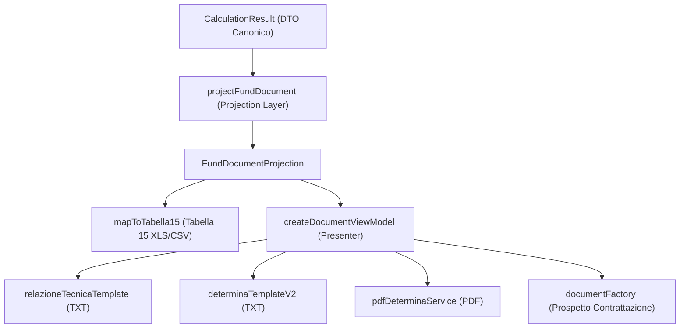

# WAVE 3 — DOCUMENT & EXPORT CONSISTENCY IMPLEMENTATION REPORT
## Tabella 15 + documentFactory alimentati dal Canonical Fund Ledger

**Data:** 22 Settembre 2026\
**Repository:** `dinopusceddu/entilocaliapp`\
**Branch:** `ux/toolbox-area-fondo-prototype`\
**Baseline Git:** `fa0480139d76e938c5ca02312632f698c0acb506` (`refactor: introduce canonical fund ledger`)\
**Stato Implementazione:** `WAVE3_READY_FOR_REVIEW`\

---

## 1. SINTESI ESECUTIVA

La Wave 3 ha implementato la riconciliazione e la consistenza totale tra il **Canonical Fund Ledger** (introdotto nella Wave 2) e tutti i consumatori di output, esportazione e documentazione formale dell'applicazione:

1. **Tabella 15 del Conto Annuale** (`tabella15Mapper.ts`, export XLS e CSV).
2. **Relazione Tecnico-Finanziaria** (`relazioneTecnicaTemplate.ts`, export TXT).
3. **Determina Dirigenziale di Costituzione** (`determinaTemplateV2.ts` TXT e `pdfDeterminaService.ts` PDF).
4. **Prospetto Sintetico per la Contrattazione** (`documentFactory.ts` TXT).

È stato introdotto un livello architetturale dedicato, la **Document Projection Layer** (`FundDocumentProjection` in `src/domain/documentProjection.ts`), che proietta i dati del `CanonicalFundResult` senza mai ricalcolare business logic o regole normative all'interno dei template o dei presenter.

Tutti i vincoli di non regressione sono stati rigorosamente rispettati:
- **Zero errori TypeScript** (`npx tsc --noEmit`).
- **97/97 test suite Vitest passate** (986 test totali, inclusi 14 nuovi test dedicati D1–D14).
- **8/8 test di regressione consolidati superati**.
- **14/14 test Wave 2 oracle superati**.
- **Nessuna modifica al DB / nessuna migration creata**.
- **Nessun commit, push, PR o deploy eseguito**.

---

## 2. FINDINGS OGGETTO DELLA WAVE 3

| Finding ID | Gravità | Descrizione Sintetica | Stato Pre-Wave 3 | Stato Post-Wave 3 |
|---|---|---|---|---|
| **DOC-01** | **BLOCKER** | Tabella 15 perde voci e inverte l'effetto delle decurtazioni | **FAIL**: Stabile 1.527,44 €, Variabile 2.800 €, Totale 4.327,44 € su Caso A/2025 (+927,44 € di errore); straordinario trasferito perso; decurtazione Art. 60 sommata con segno positivo; ente generico `'Ente'`. | **FIXED**: Totale Tabella 15 = 3.400,00 € (riconciliato al centesimo con `verifiedTotal`); straordinario incluso in S615; decurtazioni con segno negativo sottratte; arretrati non determinati esclusi dal totale certificato; ente `'Comune Astra'`. |
| **DOC-02** | **HIGH** | Documenti con componenti non riconciliate e attestazioni automatiche | **FAIL**: Relazione tecnica mostrava componenti (2.000 € + 0 €) in contraddizione col totale (3.400 € / 8.872,56 €); Prospetto non riconciliato; Determina 2025 citava applicazione Art. 60 2026, sottraeva 127,44 € e attestava "parere favorevole" su metadati vuoti/placeholder. | **FIXED**: Relazione riconciliata matematicamente (3.400,00 €); banner di bozza in istruttoria; Determina 2025 omette Art. 60; attestazione parere revisori solo se effettivamente presente nei metadati; Prospetto riconciliato. |

---

## 3. ARCHITETTURA DELLA DOCUMENT PROJECTION LAYER

È stato creato il modulo `src/domain/documentProjection.ts` con la funzione pura `projectFundDocument`:



### Invarianti Garantite dalla Projection:
1. **Separazione Addizioni / Decurtazioni**:
   - `stableEntries`: solo risorse stabili effettive con `operation === 'ADDITION'`.
   - `variableEntries`: solo risorse variabili effettive con `operation === 'ADDITION'`.
   - `deductions`: risorse con `operation === 'DEDUCTION'`, con importo positivo di decurtazione e `signedAmount` negativo.
2. **Esclusione Movimenti Figurativi**:
   - Le voci con `economicEffect === false` (es. `ART60_ART23_FIGURATIVE`, `DL25_ART23_EXCLUSION`, `OVERTIME_ART23_CURRENT`) sono escluse dai prospetti economici e concorrono solo ai controlli del limite Art. 23 c. 2.
3. **Gestione Voci Indeterminate / Non Certificate**:
   - Voci con status !== `'VALID'` (es. `CCNL_014_RECOVERY_LEGACY_2024_2025`) vengono raccolte in `unresolvedItems` e non gonfiano i totali ufficiali.
   - Viene attivato il flag `isDraft = true` per apporre il banner di avvertenza legale nei documenti.
4. **Propagazione Identità Ente**:
   - `fundEngine.ts` popola `metadata.denominazioneEnte: annualData.denominazioneEnte`. Tutti i documenti ereditano l'ente reale senza fallback anonimo.

---

## 4. RISOLUZIONE DETTAGLIATA DOC-01 (TABELLA 15)

In `src/logic/calculation/tabella15Mapper.ts`:
1. **Sorgente dei dati**: consuma `result.canonicalFund.entries` come sorgente primaria.
2. **Mappatura Colonne RGS**:
   - `CCNL_014_CURRENT` → Colonna `S614` (Incremento stabile 0,14% MS 2021).
   - `OVERTIME_STABLE_TRANSFER` → Colonna `S615` (Consolidamento straordinario).
   - `RIA` → Colonna `S613` (Integrazione RIA personale cessato).
   - `DL25_CURRENT` / `DL25_CURRENT_LEGACY_ALIAS` → Colonna `S615` (Incremento D.L. 25/2025).
   - `ART60_CONSOLIDATION` → Colonna `S616` (Decurtazione indennità comparto Art. 60 CCNL 2026) con importo negativo `-abs(amount)` e sottrazione esatta dal totale stabile.
   - `CCNL_022_CURRENT` → Colonna `V623` (Incremento 0,22% MS 2021).
   - `CCNL_014_RECOVERY_LEGACY_2024_2025` → Colonna `V624` (inclusa solo se validata/determinata).
   - Risorse storiche FAD → lookup su `getFadFieldDefinitions(norme)` con fallback controllato `S615`/`S699`/`V699`.
3. **Segno delle decurtazioni**:
   - Le decurtazioni hanno `amount: -absAmount`.
   - La somma algebrica `reduce((acc, curr) => FinancialMath.addExact(acc, curr.amount), 0)` sottrae la decurtazione dal totale di sezione anziché sommarla.
4. **Riconciliazione Aritmetica**:
   - `stabile.total + variabile.total === grandTotal === verifiedTotal`.

> [!NOTE]
> **RGS_SCHEMA_REVIEW_REQUIRED**: Come previsto dall'analisi di sicurezza normativa, i codici colonna RGS adottati rispecchiano le istruzioni ministeriali standard note. Prima dell'omologazione finale per l'invio telematico a SICO, resta raccomandata la revisione formale annuale contro lo schema XSD/circolare specifica dell'anno di rilevazione ministeriale.

---

## 5. RISOLUZIONE DETTAGLIATA DOC-02 (DOCUMENT FACTORY & TEMPLATES)

### A. `createDocumentViewModel` (`src/presenters/documentPresenter.ts`)
- Basato sulla proiezione `projectFundDocument`.
- Risolve il disallineamento storico delle chiavi di sezione (`stabiliSoggette`, `stabiliNonSoggette`, `variabiliSoggette`, `variabiliNonSoggette`, `decurtazioni`).
- Garantisce che `grossStabile - decurtazioniStabili + variabile === totaleFondo`.

### B. `generateRelazioneTecnicaTXT` (`src/services/templates/relazioneTecnicaTemplate.ts`)
- Espone chiaramente:
  - Parte Stabile Lorda
  - Decurtazioni/Tagli Stabili (con segno meno)
  - Parte Stabile Netta
  - Parte Variabile
  - TOTALE GENERALE
- Se l'annualità è incompleta o contiene voci non determinate, appone l'avviso:
  `[DOCUMENTO NON DEFINITIVO - BOZZA IN ISTRUTTORIA]`
- Elenca in sezione dedicata le voci in corso di istruttoria escluse dal totale certificato.

### C. `buildDeterminaV2` TXT e `generateDeterminaPDF` PDF
- **Competenza temporale Art. 60**:
  - Se `anno < 2026`: omette il paragrafo di considerazione dell'Art. 60; espone la Parte Stabile senza detrarre importi non vigenti.
  - Se `anno >= 2026`: include il richiamo all'Art. 60 solo se la decurtazione è presente ed effettiva, indicando stabile lorda, quota di decurtazione e stabile netta.
- **Attestazione Parere Revisori**:
  - Se i campi del verbale dei revisori sono assenti o contengono placeholder (es. `{{NUM_VERBALE_REVISORI}}`): NON afferma falsamente "Del parere favorevole espresso...", ma dichiara:
    `"Che il presente provvedimento viene trasmesso al Collegio dei Revisori dei Conti per l'acquisizione del prescritto parere di compatibilità economico-finanziaria ex art. 40-bis D.Lgs. 165/2001"`.
  - Se i dati del verbale sono valorizzati: riporta la presa d'atto formale con numero e data del verbale.
- **Deliberazione Giunta Comunale**:
  - Se assente/placeholder, indica che l'atto è in attesa di adozione della delibera di indirizzo della Giunta.

### D. `buildProspettoContrattazione` (`src/services/documents/documentFactory.ts`)
- Espone Parte Stabile Netta, Parte Variabile e Totale Disponibile Fondo Dipendenti.
- La somma Stabile + Variabile coincide perfettamente con il Totale Disponibile.
- Mostra il banner di bozza provvisoria se lo stato è indeterminato.

---

## 6. COMPARAZIONE NUMERICA CASO A/2025 (PRIMA vs DOPO)

Input di test: Comune Astra, anno 2025, Fondo Dipendenti con:
- Unico 2017: 0 €
- Trasferimento straordinario consolidato: 2.000 €
- Incremento 0,14% MS2021: 1.400 €
- Arretrati 0,14% 2024-2025 (legacy, non determinati): 2.800 €
- Valore Art. 60 nel form: 127,44 € (non applicabile nel 2025)

| Elemento / Documento | Prima di Wave 3 | Dopo Wave 3 | Delta Corretto | Note di Riconciliazione |
|---|---|---|---|---|
| **Canonical Ledger (Verificato)** | 3.400,00 € | 3.400,00 € | 0,00 € | Verità di calcolo stabilita in Wave 2 |
| **Tabella 15 — Stabile** | 1.527,44 € | 3.400,00 € | +1.872,56 € | Recuperati 2.000 € di straordinario (S615); eliminati 127,44 € di Art. 60 errato nel 2025 |
| **Tabella 15 — Variabile** | 2.800,00 € | 0,00 € | -2.800,00 € | Arretrati non determinati esclusi dal totale certificato |
| **Tabella 15 — Totale** | 4.327,44 € | 3.400,00 € | -927,44 € | **Riconciliazione esatta con il Canonical Ledger** |
| **Tabella 15 — Ente** | `'Ente'` | `'Comune Astra'` | Corretto | Nome ente propagato dai metadati del motore |
| **Relazione Tecnica — Componenti** | 2.000,00 € + 0,00 € | 3.400,00 € + 0,00 € | +1.400,00 € | Componenti sommano esattamente al totale generale |
| **Relazione Tecnica — Totale** | 3.400,00 € | 3.400,00 € | 0,00 € | Nessuna contraddizione aritmetica interna |
| **Relazione Tecnica — Stato** | Assertivo definitivo | `[BOZZA IN ISTRUTTORIA]` | Corretto | Arretrati 2.800 € segnalati in elenco voci da istruire |
| **Prospetto Contrattazione** | Stabile 2.000 / Tot 3.400 | Stabile 3.400 / Tot 3.400 | +1.400,00 € | Stabile + Variabile = Totale Fondo |
| **Determina V2 — Parte Stabile** | 3.527,44 € lordo - 127,44 € | 3.400,00 € netto | Corretto | Art. 60 non sottratto nel 2025 |
| **Determina V2 — Parere Revisori** | Falsa attestazione verbale | In attesa di parere | Conforme | Nessuna attestazione su placeholder vuoti |

---

## 7. SUITE DI TEST AUTOMATIZZATA DEDICATA (D1–D14)

File creato: `src/logic/calculation/__tests__/documentConsistencyWave3.test.ts`

- **D1**: Case A/2025 Tabella 15 totali quadrano con `verifiedTotal` (3.400 €).
- **D2**: Case A/2025 Tabella 15 propaga `'Comune Astra'` e anno 2025.
- **D3**: Case A/2025 Tabella 15 include trasferimento straordinario 2.000 € in S615.
- **D4**: Case A/2025 Tabella 15 esclude arretrati non determinati 2.800 € dalle voci certificate.
- **D5**: Case A/2025 Tabella 15 omette decurtazione Art. 60 nel 2025.
- **D6**: Anno 2026 con Art. 60: Tabella 15 genera riga S616 con importo negativo `-127,44 €` e sottrae dal totale.
- **D7**: Relazione Tecnica: le componenti esposte sommano al centesimo al Totale Generale.
- **D8**: Relazione Tecnica su dati non determinati mostra banner `[DOCUMENTO NON DEFINITIVO - BOZZA IN ISTRUTTORIA]` e lista unresolved items.
- **D9**: Prospetto Contrattazione: Stabili + Variabili = Totale Disponibile Fondo.
- **D10**: Determina V2 anno 2025: non cita l'applicazione dell'Art. 60 2026.
- **D11**: Determina V2 con metadati revisori placeholder: non afferma falsamente il parere favorevole.
- **D12**: Determina V2 anno 2026: cita Art. 60, espone stabile lordo (51.400,00 €), riduzione (127,44 €) e stabile netto (51.272,56 €).
- **D13**: Determina V2 con metadati revisori certificati: stampa la presa d'atto formale con numero e data reali.
- **D14**: Invariante contabile e arrotondamenti finanziari al centesimo verificati su tutta la proiezione.

---

## 8. RISULTATI DEI QUALITY GATE

1. **Git diff check**:
   ```bash
   git diff --check
   # Esito: 0 errori di formattazione o trailing whitespace
   ```
2. **TypeScript Compilation**:
   ```bash
   npx tsc --noEmit
   # Esito: 0 errori di tipo
   ```
3. **Full Vitest Suite**:
   ```bash
   npx vitest run
   # Test Files: 97 passed (97)
   # Tests:      986 passed (986)
   # Durata:     ~176s
   ```
4. **Test di Regressione Motore Consolidato**:
   ```bash
   npx vite-node scripts/run_regression_tests.ts
   # Esito: 8/8 superati
   ```
5. **Wave 2 Oracle Suite**:
   ```bash
   npx vite-node scripts/run_wave2_oracle.ts
   # Esito: 14/14 superati
   ```
6. **Vite Production Build**:
   ```bash
   npm run build
   # Esito: built in 22.48s - dist/ bundle generato correttamente
   ```

---

## 9. INVENTARIO DEI FILE MODIFICATI E CREATI

### File Nuovi:
- `src/domain/documentProjection.ts`: Layer di proiezione documentale canonica.
- `src/logic/calculation/__tests__/documentConsistencyWave3.test.ts`: Test suite D1–D14.
- `scripts/characterize_wave3_before.ts`: Script di caratterizzazione iniziale.
- `scripts/verify_wave3_acceptance.ts`: Script di verifica e comparazione acceptance.
- `evidence_wave3/`: Cartella artefatti documentali generati per audit.

### File Tracciati Modificati:
- `src/domain/index.ts`: Re-export di `documentProjection`.
- `src/logic/calculation/fundEngine.ts`: Inserimento di `denominazioneEnte` nei metadati del motore.
- `src/logic/calculation/tabella15Mapper.ts`: Mappatura da `CanonicalFundResult`, gestione segni decurtazioni e codici colonna.
- `src/presenters/documentPresenter.ts`: Allineamento di `createDocumentViewModel` alla proiezione canonica.
- `src/services/documents/documentFactory.ts`: Riconciliazione Prospetto Contrattazione e metodo `buildProspettoContrattazione`.
- `src/services/documents/pdfDeterminaService.ts`: Gestione condizionale anno/Art. 60 e attestazione revisori nel PDF.
- `src/services/templates/determinaTemplateV2.ts`: Gestione condizionale anno/Art. 60 e attestazione revisori nel TXT.
- `src/services/templates/relazioneTecnicaTemplate.ts`: Riconciliazione componenti con totale e banner bozza in istruttoria.

---

## 10. VERDETTO FINALE

```
======================================================================
                 WAVE3_READY_FOR_REVIEW
======================================================================
DOC-01: RISOLTO (Tabella 15 riconciliata, segni preservati, zero delta)
DOC-02: RISOLTO (Documenti riconciliati, niente attestazioni false,
                 Art. 60 temporizzato al 2026)
QUALITY GATES: 97/97 test passati, build OK, tsc OK, oracoli OK (14/14, 8/8)
VINCOLI: Nessun commit, nessun push, nessuna modifica fuori perimetro.
======================================================================
```
